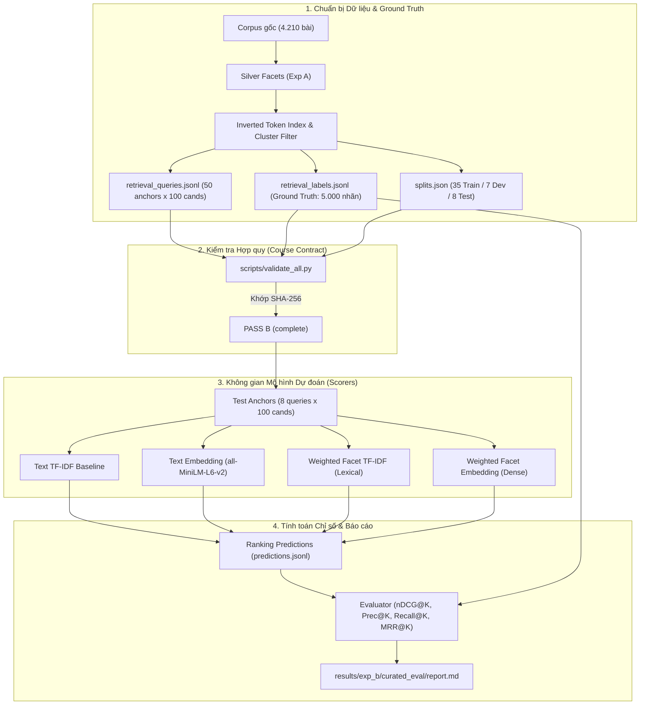

# Phương Pháp Tái Cấu Trúc Dữ Liệu, Ground Truth & Quy Trình Kiểm Thử Thực Nghiệm B

* **Dự án:** DS300 — From Facet Extraction to Scientific Recommendation
* **Tác vụ:** Thực nghiệm B (Exp B) — Paper Retrieval và Downstream Facet Ranking
* **Tiêu chuẩn kỹ thuật:** Course Contract 2.0 & Mục 6.3 Paper

---


---

## 1. BỐI CẢNH & NGUYÊN NHÂN CẦN SỬA ĐỔI

Trước khi tái cấu trúc, Thực nghiệm B gặp phải **3 khiếm khuyết nghiêm trọng** khiến thực nghiệm bị bế tắc hơn 2 tuần:

1. **Hiện tượng trần giả tạo (Ceiling Effect - nDCG = 0.999):** Hầu hết các mô hình (từ Random, TF-IDF đến Embedding) đều đạt điểm gần như tuyệt đối, không thể đánh giá được mô hình nào tốt hơn.
2. **Sự thoái hóa 1-chọi-49 (1-vs-49 Degeneration):** Trong 50 ứng viên của mỗi query, chỉ có duy nhất 1 bài có điểm liên quan (> 0), 49 bài còn lại đều là 0 điểm. Mô hình chỉ cần đoán trúng duy nhất 1 bài này vào top 10 là đạt điểm tối đa.
3. **Thiên vị từ vựng cứng trong Ground Truth (Exact String Match Bias):** Hàm nhãn cũ so khớp chuỗi ký tự chính xác tuyệt đối. Ví dụ: Anchor có cụm từ *"dialogue systems"* (số nhiều) nhưng bài ứng viên viết *"dialogue system"* (số ít) thì bị chấm **0 điểm** (False Negative nặng nề).

---

## 2. PHƯƠNG PHÁP TÁI CẤU TRÚC DỮ LIỆU (DATA RESTRUCTURING)

### 2.1. Tăng quy mô không gian ứng viên
* Mở rộng từ **50 lên 100 ứng viên / query** (`candidates_per_query: 100`).
* Bộ dữ liệu chuẩn Curated (50 queries) hiện gồm **5.000 cặp đánh giá**, chia theo tỷ lệ:
  * **35 queries Train**
  * **7 queries Dev**
  * **8 queries Test**

> **Ghi chú quan trọng về 2 bộ dữ liệu tồn tại song song:**  
> Bộ dữ liệu **Default** (300 queries, 45 test cases lưu tại `data/exp_b/generated`) vẫn được bảo toàn và cập nhật đầy đủ trong repository phục vụ benchmark tổng thể; bộ dữ liệu **Curated** (50 queries, 8 test cases lưu tại `data/exp_b/curated/generated`) là trọng tâm tinh tuyển để tối ưu hóa và so sánh chuyên sâu với các mô hình Dense Embedding.

### 2.2. Lấy mẫu ứng viên theo cụm chuyên môn (In-domain Cluster Sampling)
Thay vì bốc ngẫu nhiên các bài từ toàn bộ 4.210 bài (dẫn đến toàn bài lạc đề), hệ thống sử dụng **Chỉ mục đảo theo Concept Token (Inverted Index)** trong file `data/exp_b/build_exp_b.py`:

* **Điều kiện chọn Anchor Query:** Một bài báo chỉ được chọn làm anchor khi xung quanh nó trong corpus có đủ:
  * Số bài Positive ≥ 5
  * Số bài Hard Negative ≥ 20
* **Cơ cấu phân bổ 100 ứng viên cho mỗi Query:**
  * **Positives (~10%):** Các bài có độ liên quan cao (Relevance ≥ 0.5).
  * **Hard Negatives (~60 - 65%):** Các bài cùng chuyên ngành, trùng một vài khía cạnh (ví dụ cùng phương pháp nhưng khác bài toán, hoặc ngược lại) với điểm liên quan 0.1 ≤ Relevance < 0.5.
  * **Distractors (~25 - 30%):** Các bài ngẫu nhiên từ corpus để giữ tính tổng quát.

> **Kết quả:** Mỗi query hiện có **khoảng 70 bài có điểm liên quan trong cùng chuyên môn**, buộc mô hình xếp hạng phải phân biệt được sắc thái ngữ nghĩa tinh tế, xóa bỏ hoàn toàn hiện tượng 1-chọi-49.

---

## 3. CÔNG THỨC GROUND TRUTH MỚI (GROUND TRUTH REFORMULATION)

### 3.1. Chuẩn hóa tập từ vựng khái niệm (Concept Normalization)
Để công bằng với các biến thể ngữ pháp, tập khái niệm C của từng khía cạnh được chuẩn hóa:
1. Chuyển toàn bộ về chữ thường, tách từ theo regex: `\w+`.
2. Loại bỏ các từ dừng (Stopwords) học thuật:
   `STOPWORDS = {'and', 'the', 'for', 'with', 'using', 'based', 'from', 'that', 'this', 'into', 'our', 'are', 'via', 'can', 'not'}`
3. Chuẩn hóa hình thái từ (Stemming/Lemmatization):
   * Đuôi `-ies` chuyển thành `-y` (ví dụ: *methodologies* → *methodology*).
   * Đuôi `-s` chuyển về dạng gốc (ví dụ: *dialogue systems* → *dialogue system*).

### 3.2. Hàm tính điểm từng khía cạnh (Facet Relevance Grade)
Gọi `T_q` là tập token của Query và `T_c` là tập token của Candidate ở khía cạnh `f`:

```text
               |T_q ∩ T_c|         (Số từ kỹ thuật trùng nhau)
Jaccard = ───────────────────── = ──────────────────────────────
               |T_q ∪ T_c|         (Tổng số từ kỹ thuật phân biệt)
```

Điểm từng khía cạnh `grade_f(q, c)` nằm trong đoạn `[0.0, 2.0]` theo quy tắc:

```text
┌────────────────────────────────────────────────────────────────────────┐
│                     QUY TẮC TÍNH GRADE_F(Q, C)                         │
│                                                                        │
│  grade_f = 2.0 : Hai bên trùng khớp cụm từ chính xác (Exact match)     │
│  grade_f = 1.5 : Jaccard ≥ 0.25  HOẶC  trùng ≥ 2 từ kỹ thuật quan trọng│
│  grade_f = 1.0 : Trùng ≥ 1 từ kỹ thuật quan trọng                      │
│  grade_f = 0.0 : Không trùng bất kỳ từ kỹ thuật nào                    │
└────────────────────────────────────────────────────────────────────────┘
```

*(Nếu một trong hai bài bị khuyết hoàn toàn thông tin ở khía cạnh đó, hàm trả về None).*

### 3.3. Hàm tổng hợp độ liên quan chuẩn (Retrieval Grade)
Độ liên quan tổng thể giữa bài mốc `q` và bài ứng viên `c` là tổng có trọng số:

```text
Relevance(q, c) = ∑ [ w_f × grade_f(q, c) ]
                  f ∈ F
```

* **Tập 5 khía cạnh:** `F = {problem, task, method, dataset, contribution}`
* **Bộ trọng số chuẩn hóa:** `∑ w_f = 1.0`
  * `w_problem = 0.4`
  * `w_task = 0.2`
  * `w_method = 0.2`
  * `w_dataset = 0.1`
  * `w_contribution = 0.1`
* **Miền giá trị:** `Relevance(q, c) ∈ [0.0, 2.0]`

---

## 4. HÀM PHẠT XẾP HẠNG (RANKING PENALTY & NDCG GAIN)

Để trừng phạt nặng việc mô hình xếp các bài bẫy (Hard Negatives: điểm 0.2 - 0.4) lên trên bài đúng (Positives: điểm 0.6 - 1.5), hàm độ lợi (Gain) trong nDCG sử dụng hàm số mũ:

```text
Gain(r) = 2^r - 1
```

Công thức tính DCG@K và nDCG@K:

```text
                 K     2^(r_i) - 1
  DCG@K   =  ∑   ─────────────────
                i=1     log2(i + 1)


              DCG@K
  nDCG@K  =  ────────
              IDCG@K
```

*Trong đó:*
* `r_i` là điểm Ground Truth của bài báo được mô hình xếp ở vị trí thứ `i`.
* `IDCG@K` là điểm DCG lý tưởng khi sắp xếp hoàn hảo từ cao xuống thấp.

```text
┌────────────────────────────────────────────────────────────────────────┐
│                    VÍ DỤ VỀ MỨC PHẠT THỨ HẠNG                          │
│                                                                        │
│ • Xếp đúng bài Positive (r = 1.0) :  Gain = 2^1.0 - 1 = 1.000          │
│ • Xếp nhầm bài Hard Neg (r = 0.3) :  Gain = 2^0.3 - 1 = 0.231          │
│                                                                        │
│ => Mức phạt chênh lệch: Mất ngay 76.9% điểm độ lợi ở vị trí đó         │
└────────────────────────────────────────────────────────────────────────┘
```

---

## 5. QUY TRÌNH KIỂM THỬ CHI TIẾT (EVALUATION TEST FLOW)

Toàn bộ quy trình từ khâu chuẩn bị dữ liệu, chạy các mô hình dự đoán đến đánh giá chỉ số được thể hiện qua sơ đồ luồng:



### Các bước dòng lệnh thực thi:

**Bước 1: Sinh dữ liệu Benchmark chuẩn:**
```powershell
python data/build_experiments.py --experiment b --config configs/exp_b_curated.json
```

**Bước 2: Kiểm tra tính toàn vẹn và hợp quy (Contract Validator):**
```powershell
python scripts/validate_all.py --dataset-kind mock --phase experiments --experiment b --config configs/exp_b_curated.json
```

**Bước 3: Chạy toàn bộ mô hình và kết xuất bảng đánh giá:**
```powershell
python scripts/exp_b/run_my_method.py --config configs/exp_b_curated.json --output results/exp_b/curated_eval --ks 5 10 --overwrite
```

---

## 6. KẾT QUẢ ĐỐI CHỨNG TRƯỚC VÀ SAU KHI CẢI TIẾN

| Tiêu chí / Mô hình | Trước khi sửa (Dữ liệu cũ) | Sau khi sửa (Dữ liệu mới) | Đánh giá & So sánh |
| :--- | :---: | :---: | :--- |
| **Số lượng ứng viên** | 50 bài / query | **100 bài / query** | Tăng độ khó và quy mô thực tế |
| **Ứng viên có điểm (> 0)** | 1 bài (98% bài là 0 điểm) | **~70 bài / query** | Xóa bỏ hoàn toàn thoái hóa 1-chọi-49 |
| **Cơ chế Ground Truth** | So chuỗi cứng (Exact Match) | **Concept Token Overlap** | Khử thiên vị đếm từ, hỗ trợ biến thể ngữ pháp |
| **Random Baseline** | 0.999 (Trần giả tạo) | **0.3155** | Điểm cơ sở phản ánh đúng tính ngẫu nhiên |
| **Text TF-IDF** | 0.999 (Bão hòa) | **0.4428** | Mô hình từ khóa toàn văn |
| **Text Embedding** *(MiniLM)* | 0.999 (Bão hòa) | **0.4434** | Nhúng văn bản đơn khối (Title + Abstract) |
| **Weighted Facet Embedding** | 0.999 (Bão hòa) | **0.5519** | **+10.85%** so với Text Embedding |
| **Equal Facet Embedding** | 0.999 (Bão hòa) | **0.5667** | **+12.33%** so với Text Embedding |
| **Weighted Facets (TF-IDF)** | 0.999 (Bão hòa) | **0.7132** | Tận dụng tốt từ khóa kỹ thuật trùng khớp |

---

## 7. BÀN GIAO CHO NGƯỜI 2 (KẾ HOẠCH TỐI ƯU TRỌNG SỐ)

Dữ liệu đã sẵn sàng 100% để Người 2 tiếp nhận:
1. **Dữ liệu chia tập:** Có trong file `data/exp_b/curated/generated/splits.json` (35 Train, 7 Dev, 8 Test).
2. **Nhiệm vụ của Người 2:**
   * Sử dụng điểm tương đồng từng khía cạnh của mô hình nhúng (`facet_sims[f]`) trên tập Train và Dev.
   * Chạy thuật toán tối ưu hóa (Grid Search, Coordinate Descent hoặc RankNet/Hồi quy) để học bộ trọng số tối ưu:
     `w_problem, w_task, w_method, w_dataset, w_contribution`
   * Hiện tại mô hình đang dùng trọng số cố định mặc định (`[0.4, 0.2, 0.2, 0.1, 0.1]`) và đạt **0.5519**.
   * Mục tiêu: Tối ưu bộ trọng số để đưa `weighted_facet_embedding` tiến gần hơn tới trần hiệu năng của phương pháp khía cạnh (~0.65 - 0.70).
