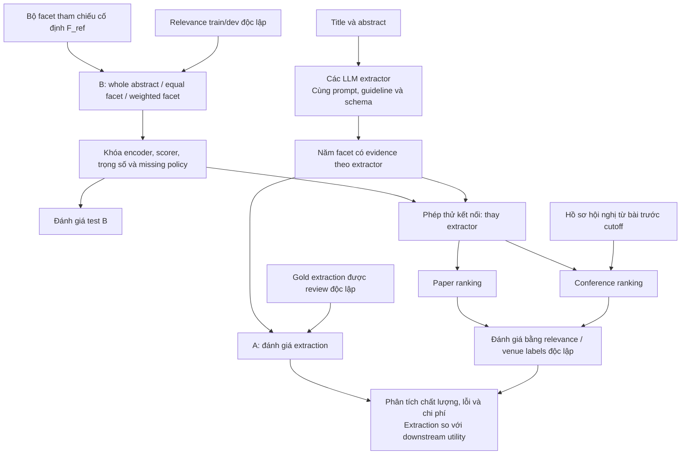

# DS300 — Đánh giá LLM trích xuất facet cho khuyến nghị bài báo và hội nghị

Dự án nghiên cứu ảnh hưởng của **LLM trích xuất năm facet khoa học có dẫn chứng** tới chất lượng **tìm bài báo liên quan** và **khuyến nghị hội nghị từ nội dung manuscript**. Đầu vào chính là title và abstract; năm facet gồm `problem`, `task`, `method`, `dataset`, `contribution`.

Phạm vi nghiên cứu hiện tại tập trung vào **thực nghiệm A, thực nghiệm B và nhánh conference**, cùng phép thử kết nối extraction với downstream ranking. Định hướng chi tiết nằm trong [đề cương nghiên cứu](docs/PAPER_STRUCTURE_SHARED_FACET_WEIGHTS_2026-10-23.md).

## Bài toán và mục tiêu

Một extractor có điểm trích xuất cao chưa tự chứng minh rằng đầu ra của nó giúp xếp hạng bài báo hoặc hội nghị tốt hơn. Dự án so sánh các extractor dưới cùng điều kiện downstream để xác định chất lượng extraction, loại lỗi và chi phí liên hệ thế nào với hiệu quả khuyến nghị.

Mỗi facet mô tả một vai trò trong nội dung bài:

| Facet | Nội dung |
|---|---|
| Problem | Vấn đề nghiên cứu được giải quyết |
| Task | Nhiệm vụ cụ thể của bài |
| Method | Phương pháp được sử dụng hoặc đề xuất |
| Dataset | Dữ liệu, bộ dữ liệu hoặc tài nguyên được sử dụng |
| Contribution | Đóng góp được bài báo trình bày |

Concept đi kèm evidence từ văn bản nguồn. Facet thiếu bằng chứng được phép để rỗng. Phạm vi phương pháp chính là title/abstract; xử lý full text và giao diện upload PDF chưa phải yêu cầu của thực nghiệm offline.

Hai đầu ra downstream hướng tới:

- **Paper ranking:** từ một bài mốc hoặc manuscript, xếp hạng các bài liên quan.
- **Conference ranking:** từ manuscript, xếp hạng hội nghị theo mức phù hợp nội dung với hồ sơ các bài lịch sử của hội nghị.

## Câu hỏi nghiên cứu và đóng góp dự kiến

| Câu hỏi | Thực nghiệm |
|---|---|
| Các LLM trích năm facet đúng, đủ và có evidence phù hợp đến đâu? | A — đánh giá extraction |
| Với bộ facet đầu vào cố định, chia facet và gán trọng số có cải thiện ranking so với whole abstract không? | B — so sánh biểu diễn và trọng số |
| Khi giữ downstream cố định, thay extractor ảnh hưởng thế nào đến paper và conference ranking? | Phép thử kết nối và nhánh conference |
| Điểm extraction, kiểu lỗi và chi phí có giải thích được khác biệt downstream không? | Phân tích kết hợp |

Đóng góp dự kiến gồm protocol so sánh extractor thống nhất, đánh giá có kiểm soát về facet representation/trọng số và phân tích extraction quality với downstream utility. Các kết luận cần dựa trên kết quả thực nghiệm; không mặc định weighted facets sẽ thắng hoặc extractor có F1 cao nhất sẽ xếp hạng tốt nhất.

Đối chiếu phương pháp nằm trong [khảo sát facet và venue recommendation](docs/FOCUSED_FACET_PAPER_VENUE_RESEARCH_2026-10-23.md) và [prior art về extractor–downstream](docs/EXTRACTOR_DOWNSTREAM_PRIOR_ART_2026-10-23.md).

## Thiết kế thực nghiệm

### A — Chất lượng trích xuất năm facet

So các LLM trên cùng title/abstract, nội dung prompt, guideline và schema; dùng chat template phù hợp từng model và ghi rõ checkpoint, decoding, token budget, retry cùng phiên bản pipeline.

Đánh giá dự kiến gồm Precision/Recall/F1 theo facet, micro/macro, mức hỗ trợ của evidence, tỷ lệ thất bại và chi phí khi đo được. Giữ rõ nguồn annotation tham chiếu: kết quả với AI reference phải được phân biệt với kết quả trên gold do người review độc lập.

Tài liệu thực thi: [dữ liệu và extraction A](data/exp_a/README.md), [đánh giá A](scripts/exp_a/README.md), [guideline](docs/FACET_GUIDELINE.md), [quy trình review](scripts/exp_a/docs/SEMANTIC_REVIEW_PROTOCOL.md).

### B — Whole abstract, equal facet và weighted facet

B sử dụng một bộ facet tham chiếu cố định `F_ref`, cùng candidate pools và relevance labels để so ba phương pháp:

| Phương pháp | Cách xếp hạng dự kiến |
|---|---|
| Whole abstract | Encode title/abstract, so độ tương tự toàn bài |
| Equal facet | Encode từng facet, tổng hợp với trọng số bằng nhau |
| Weighted facet | Cùng biểu diễn facet, tổng hợp với trọng số chọn trên train/dev B |

B có thể chạy khi đã có `F_ref`, không cần đợi điểm A hoặc đợi A chọn extractor tốt nhất. `F_ref` là đầu vào tham chiếu, không mặc định là gold. Nguồn `F_ref`, encoder, cách tạo facet text và chính sách xử lý facet thiếu cần được chốt trước test.

Sau khi chọn cấu hình trên train/dev, khóa encoder, scorer và trọng số `w_B`. Trong phép thử kết nối, dùng cùng cấu hình đó cho đầu ra của mọi extractor; không tune riêng từng extractor. Thay facet ở cả query và candidates để giữ điều kiện so sánh nhất quán.

Dùng nhãn relevance độc lập với công thức facet scoring để đánh giá lợi ích thực tế. Metric chính cần chốt theo dữ liệu; đề xuất nDCG@10, kèm các metric ranking phù hợp. Ranking trong pool cố định phải được phân biệt với retrieval toàn corpus.

Tài liệu baseline hiện có: [generator B](data/exp_b/README.md), [runner và evaluator B](scripts/exp_b/README.md), [nguồn dữ liệu B](docs/DATASET_B_SOURCES_2026-10-23.md).

### Conference — Khuyến nghị hội nghị từ manuscript

Dùng title/abstract của manuscript để đối chiếu với hồ sơ hội nghị được xây từ các bài lịch sử trước cutoff. Phương án khởi đầu đề xuất là centroid theo facet, so với baseline centroid toàn abstract.

Với từng extractor, trích facet cho cả manuscript và các bài xây hồ sơ hội nghị. Giữ catalog, lịch sử, thời điểm và cách tổng hợp giống nhau; loại query và bản trùng/gần trùng khỏi hồ sơ. Cần kiểm tra định danh conference series, edition, workshop, năm công bố và coverage trước khi xây tập đánh giá.

Trọng số phải **chung giữa các extractor trong cùng điều kiện so sánh**. Việc dùng nguyên `w_B` để kiểm tra transfer hay chọn bộ `w_V` chung trên conference dev vẫn cần chốt. Không tự hiểu shared weights là bắt buộc hai tác vụ dùng cùng trọng số.

Đề xuất MRR/Recall@3 hoặc @5 cho venue thực tế đã công bố; bổ sung nhãn graded suitability trên một subset nếu đánh giá mức phù hợp đa hội nghị. Venue đã đăng là observed positive, chưa chứng minh các venue khác không phù hợp. Đầu ra đánh giá mức phù hợp nội dung, không phải xác suất được nhận bài.

## Luồng nghiên cứu dự kiến

Sơ đồ mô tả thiết kế mục tiêu; trạng thái triển khai hiện có được ghi riêng bên dưới.

Nhãn test chỉ dùng đánh giá, không dùng chọn extractor, tune trọng số hoặc xây hồ sơ hội nghị. Cần subset giao nhau giữa gold extraction và downstream queries nếu muốn phân tích tác động lỗi ở cấp từng bài/query.

## Trạng thái triển khai và dữ liệu

| Thành phần | Hiện có và phần cần tiếp tục |
|---|---|
| Corpus | Corpus canonical 4.210 title/abstract; metadata venue/year cần được kiểm tra hoặc bổ sung cho conference |
| A | Có pipeline Qwen, facet/evidence, evaluator và các báo cáo base/QLoRA; nghiên cứu nhiều extractor cần khóa protocol so sánh chung |
| B baseline | Có `random`, `text_tfidf`, `equal_facets`, `weighted_facets`; scorer lexical, trọng số cố định, ranking trên candidate pool |
| Dữ liệu B trên máy, kiểm tra 24/10/2026 | Manifest ghi 18 query và 1.800 cặp có nhãn, so với mục tiêu cấu hình 300 query × 100 candidates; đây là dữ liệu mock với nhãn weighted overlap từ facet |
| Semantic ranking và shared weights | Là thiết kế nghiên cứu cần triển khai/kiểm chứng; encoder embedding dùng ghép nhãn đánh giá A không đồng nghĩa ranker B đã dùng semantic encoder |
| Conference | Chưa có pipeline thực nghiệm riêng trong cấu trúc A–E hiện có; cần chốt nguồn, catalog, temporal split, hồ sơ hội nghị và nhãn |

Kết quả B trên nhãn mock phản ánh giả định sinh dữ liệu, chưa đủ xác nhận lợi ích semantic ranking trên nhãn độc lập. Việc corpus lấy bài thật không làm nhãn mô phỏng trở thành đánh giá người dùng thật.

## Bắt đầu từ đâu?

| Nhu cầu | Tài liệu |
|---|---|
| Nắm hướng đề tài và các quyết định còn mở | [Đề cương A/B/conference](docs/PAPER_STRUCTURE_SHARED_FACET_WEIGHTS_2026-10-23.md) |
| Đọc nguồn, corpus và provenance | [Chỉ mục dữ liệu](data/README.md), [corpus canonical](data/processed/README.md), [nguồn gốc](data/raw/README.md) |
| Chuẩn bị và đánh giá A | [Dữ liệu A](data/exp_a/README.md), [runner A](scripts/exp_a/README.md), [đánh giá Qwen](docs/EVALUATE_QWEN.md) |
| Đọc kết quả extraction đã có | [So sánh base v1/v2](scripts/exp_a/docs/BASE_V1_V2_COMPARISON_2026-10-20.md), [QLoRA v1](scripts/exp_a/docs/QLORA_V1_PROGRESS_2026-10-16.md), [test QLoRA v2](scripts/exp_a/docs/QLORA_V2_TEST_RESULT_2026-10-20.md) |
| Chuẩn bị và chạy baseline B | [Dữ liệu B](data/exp_b/README.md), [runner B](scripts/exp_b/README.md) |
| Viết scorer theo giao diện hiện có | [Hướng dẫn baseline](scripts/BASELINE_GUIDE.md) |
| Tra schema và quy trình của code hiện có | [Data contract](DATA_CONTRACT.md), [protocol A–E](docs/EXPERIMENT_PROTOCOL.md), [lệnh chạy](docs/RUN_EXPERIMENTS.md) |

## Code và tài liệu của hướng cũ

Các thực nghiệm **C — profile**, **D — ý định theo phiên**, **E — thích ứng theo thời gian** được đưa ra ngoài phạm vi nghiên cứu chính. Code, config, dữ liệu và hướng dẫn tương ứng vẫn được giữ để tra cứu và tái lập các lần chạy cũ.

[Chỉ mục scripts](scripts/README.md), [protocol A–E](docs/EXPERIMENT_PROTOCOL.md), [quản lý dự án](docs/PROJECT_OPERATIONS.md) và [kế hoạch A–E ngày 10/10](docs/EXPERIMENT_PLAN_FINAL.md) còn mô tả cấu trúc triển khai trước đây. Dùng chúng để hiểu code hiện có; dùng [đề cương ngày 23/10](docs/PAPER_STRUCTURE_SHARED_FACET_WEIGHTS_2026-10-23.md) để xác định hướng nghiên cứu tiếp theo. Nhánh conference giữ tên riêng, không đổi thành C cũ.
