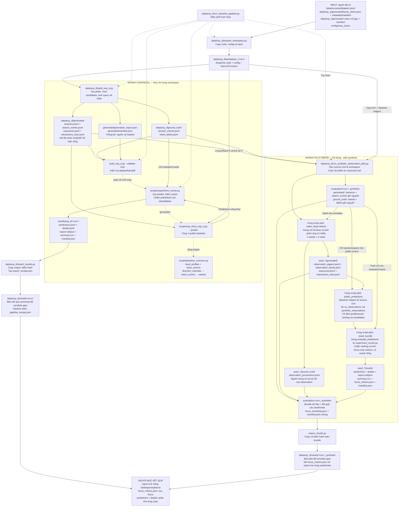

# Tổng quan thí nghiệm D: dữ liệu, nhiệm vụ và vấn đề đang gặp

**Để chuẩn bị báo cáo với nhóm, đọc [bao_cao_nhom_D.md](bao_cao_nhom_D.md) trước:** tài liệu đó giải thích bài toán bằng ví dụ, cách đọc metrics của run `baseline_20261016_v1`, code đã thay đổi và những kết luận được phép rút ra. Xem [changed.md](changed.md) cho bản đối chiếu nguồn hiện tại với Git HEAD.

Cập nhật: 2026-10-16. Trạng thái hiện tại đối chiếu theo lượt `baseline_20261016_v1` và `baseline_20261016_v1_synthetic`; các phương án chưa triển khai được ghi rõ là đề xuất.

**Cập nhật mới nhất:** đã triển khai [pilot observation tổng hợp](../SYNTHETIC_OBSERVATION_PILOT.md) theo báo cáo thiết kế bổ sung. Bộ D canonical/baseline cũ vẫn không có exposure; pilot riêng đã có 30 phiên, 120 exposures và 240 interactions mỗi cấu hình, chạy 3 seed × 2 mức nhiễu. Không sửa corpus/A/C hoặc scorer/validator chung. Các đoạn “chưa triển khai observation” bên dưới mô tả giai đoạn sửa generator thật trước pilot, không phải trạng thái của overlay mới. Pilot dùng nhãn và candidates thật giữ nguyên; observation có provenance synthetic riêng, không phải silver A.

## 1. Các thuật ngữ cần hiểu trước

| Thuật ngữ | Hiểu đơn giản | Ví dụ / lưu ý trong D |
|---|---|---|
| Corpus | Tập bài báo làm nguồn | 4.210 bài thật; 3.240 bài vượt bộ lọc annotation hiện hành. Không phải tất cả đều phù hợp với mọi phiên |
| Facet | Một khía cạnh của bài báo | `problem`: vấn đề; `task`: tác vụ; `method`: phương pháp; `dataset`: dữ liệu dùng trong nghiên cứu; `contribution`: đóng góp |
| Concept | Cụm từ mô tả nội dung trong một facet | `method = ["graph neural networks"]`; một facet có thể chứa nhiều concept |
| Silver | Annotation được máy/mô hình trích, chưa phải đáp án được người kiểm duyệt đầy đủ | Năm facet từ A là silver. Vượt bộ lọc cờ chất lượng không bảo đảm mọi concept đều đúng |
| Evidence | Dẫn chứng hỗ trợ annotation hoặc tín hiệu hỗ trợ suy luận | Dẫn chứng extraction A khác với evidence hành vi/query để suy intent trong D |
| User | Danh tính người dùng | 300 user mô phỏng kế thừa từ C, không phải 300 người thật |
| Session | Một phiên khuyến nghị, có một nhu cầu cụ thể | Một user có 5 phiên; mỗi phiên có bài mốc, context, 20 candidates và cutoff |
| Case | Một đơn vị để chạy và chấm phương pháp | Trong D hiện tại, một session tương ứng một case; `case_id` liên kết các file |
| Anchor / query paper | Bài mốc người dùng đang đọc | Trường `query_paper_id`; khác query tìm kiếm dạng văn bản |
| Intent | Ý định trong phiên: muốn giữ điều gì, thay đổi điều gì | “Vẫn nghiên cứu cùng problem, nhưng tìm method khác” |
| Context | Facet cần giữ liên quan để xác định phạm vi phiên | Ví dụ giữ cùng `problem`; `context_facet` được cung cấp sẵn cho phương pháp |
| Focus | Facet mà phiên đang quan tâm hướng similar/different | Ví dụ `method`; focus thật được giấu trong ground truth |
| Direction | Hướng mong muốn trên từng facet | `similar`, `different`; có thêm `ignore` trong intent thật và `unknown` khi dự đoán |
| `similar` | Muốn giống ở facet đang xét | Nhãn mô phỏng dùng giao concept, không mặc định là hiểu giống nhau về ngữ nghĩa |
| `different` | Muốn khác ở facet đang xét | Không có giao concept khi hai bài đều có dữ liệu facet; facet thiếu không tự được tính là khác hợp lệ |
| `ignore` | Facet không thuộc intent đang đánh giá | Intent thật chỉ active context và focus; ba facet còn lại ignore, weight 0 |
| `unknown` | Phương pháp chưa đủ bằng chứng để xác định hướng | Không đồng nghĩa ignore, cũng không phải nhãn đầu vào bị thiếu. Khi chấm hướng, unknown là bỏ lỡ dự đoán trên facet active |
| Importance / weight | Mức quan trọng của từng facet | Intent thật đặt context 0,6, focus 0,4. Baseline thông thường dùng importance suy từ lịch sử C |
| Query / reformulation | Câu tìm kiếm / câu tìm kiếm được điều chỉnh | Ví dụ `method: alternatives to GNN`; khác `query_paper_id` |
| Exposure | Bản ghi những bài đã được hiển thị | Trong D, một exposure chứa hai bài dùng làm cặp quan sát |
| Interaction / feedback | Phản ứng sau khi hiển thị bài | `view`, `click`, `save`, `like`, `dislike`; canonical hiện rỗng, pilot synthetic có phản ứng mô phỏng |
| Matched pair | Cặp bài để so phản ứng với same-focus và different-focus | Cùng context; các facet ngoài focus có trạng thái overlap/missing tương đương |
| Candidate pool | Tập bài phương pháp phải xếp hạng | 20 IDs mỗi phiên; tách khỏi bài quan sát dùng để suy hướng |
| Overlap | Có ít nhất một concept chung sau chuẩn hóa hiện hành | Không phải semantic similarity; hai cách diễn đạt đồng nghĩa chưa chắc overlap |
| Missing facet | Facet không có annotation dùng được | `[]`; không tự điền concept hoặc coi là different |
| Cutoff | Thời điểm chốt thông tin phương pháp được thấy | Không được dùng log tương lai sau cutoff |
| Ground truth | Đáp án được giữ riêng để đánh giá | Ở D là intent/relevance mô phỏng, không phải human gold |
| Baseline | Phương pháp tham chiếu có sẵn | Dùng làm mốc để kiểm chứng phương pháp hoặc giả thuyết tiếp theo |
| Scorer / ranker | Thuật toán cho điểm và sắp xếp candidates | Không được đọc hidden intent/relevance |
| Evaluator | Bộ phận đối chiếu prediction với đáp án | Được đọc ground truth; thêm oracle riêng |
| Oracle | Đối chứng biết sẵn intent thật | Có thông tin đặc quyền; không phải phương pháp dùng được khi chưa biết nhu cầu và không mặc định là trần toán học |
| Abstain | Từ chối kết luận khi thiếu bằng chứng | Thể hiện bằng unknown; protocol cho phép thiếu cặp và abstain |
| Pilot | Thử nghiệm quy mô nhỏ để kiểm tra cơ chế trước khi mở rộng | Pilot hiện tại chọn 30 phiên/28 anchors từ canonical mới; chưa phải test cuối để chứng minh tổng quát hóa |
| Synthetic | Dữ liệu được tạo có chủ đích thay vì thu trực tiếp từ thực tế | Pilot dựng mô tả bài quan sát và phản ứng; không gọi chúng là bài báo hoặc hành vi người dùng thật |
| Observation | Thông tin quan sát được để suy intent | Trong cụm “synthetic observation”, chủ yếu là các bài/cặp được dựng để hiển thị và lấy phản ứng; rộng hơn, evidence đầu phiên còn gồm query |
| Synthetic overlay | Lớp dữ liệu tổng hợp bổ sung riêng lên các phiên đã chọn | Giữ nguyên sessions/query/candidates/labels nguồn, thêm observation/exposure/interaction; không sửa corpus/A/C |
| Canonical | Bộ dữ liệu theo pipeline chính và hợp đồng đầu vào chuẩn | Anchor/candidates lấy từ corpus thật; user/intent/query/relevance vẫn là mô phỏng, không đồng nghĩa toàn bộ dữ liệu đều thật |
| Simulator / utility | Bộ sinh hành vi và mức ưa thích giả định trước khi đổi thành action | Pilot dùng utility 0,7 nếu thỏa intent, 0,05 nếu không, cộng nhiễu rồi qua thresholds để sinh phản ứng |
| Seed / noise | Seed điều khiển chuỗi ngẫu nhiên; noise làm phản ứng bớt nhất quán | Pilot chạy seeds 42/43/44 × noise 0,2/0,5 để kiểm tra độ nhạy với ngẫu nhiên và nhiễu |
| Control / ablation | Đối chứng / phép thử thay một thành phần để xem tác dụng của nó | So `no_observations` và `synthetic_observations` trên cùng 30 phiên để xét tác động của observation |
| Focus-only metrics | Chỉ số chỉ chấm facet focus thật của phiên | Xem `focus_accuracy`, `focus_coverage`, `focus_macro_f1`; tránh nhầm điểm context được cho sẵn với khả năng suy focus |
| Compliance@k | Tỷ lệ bài top-k thỏa cả context và hướng focus theo nhãn | Chỉ grade 2 được tính; Recall/MRR hiện nhận cả grade 1 nên không thay được compliance |
| Workspace / snapshot | Bản sao code, config và input dùng riêng cho một lượt chạy | `prepare_workspace.py` tạo `workspace_<name>/`; sửa code gốc sau đó không tự đổi snapshot |
| Handoff / provenance | Gói dữ liệu bàn giao / thông tin nguồn gốc của dữ liệu | A/C có đầu vào và manifest riêng; observation synthetic có provenance riêng, không nhận là silver A |
| Manifest / hash | Bản kê nguồn, cấu hình và dấu kiểm tra nội dung file | Dùng kiểm tra đúng phiên bản và nội dung có đổi không; không bảo đảm annotation đúng ngữ nghĩa |
| Export / receipt | Copy kết quả để bàn giao / biên nhận lần copy hoặc chạy | `export_results.py` kiểm hash khi copy; `export_receipt.json` và `pipeline_receipt.json` giúp truy lại nguồn kết quả |

**Phân biệt ba trường hợp:** `similar` = đã dự đoán muốn giống; `unknown` = chưa biết muốn gì; `ignore` = facet không nằm trong intent thật của phiên. Khi unknown, scorer hiện fallback similar để xếp hạng, nhưng prediction vẫn unknown khi chấm hướng.

## 2. Data của D gồm những thuộc tính nào?

D không nằm trong một bảng duy nhất. Mỗi dòng JSONL là một bản ghi; ID dùng để nối các file. `case_id` trong sessions/intents/labels tương ứng `session_id` trong logs.

### 2.1. Phần phương pháp được quan sát

| File trong `data/exp_d/` | Các trường | Vai trò / điều cần kiểm tra |
|---|---|---|
| `generated/sessions.jsonl` | `case_id`, `user_id`, `query_paper_id`, `context_facet`, `candidate_ids`, `cutoff` | Xác định phiên, anchor, context và pool cần ranking. Kiểm tra ID, đủ 20 candidates riêng, không chứa anchor |
| `generated/search_events.jsonl` | `query_id`, `user_id`, `session_id`, `text`, `parent_query_id`, `timestamp` | Query đầu phiên. Kiểm tra text có tín hiệu gì, đúng user/session, quan hệ reformulation và trước cutoff |
| `generated/exposures.jsonl` | `exposure_id`, `user_id`, `session_id`, `query_id`, `paper_ids`, `timestamp` | Cặp đã hiển thị; hiện không có dòng nào. Schema này là cấu trúc generator sẽ tạo nếu tìm được cặp |
| `generated/interactions_train.jsonl` | `user_id`, `paper_id`, `interaction_type`, `timestamp`, `session_id`, `exposure_id` | Phản ứng trên bài được hiển thị; hiện không có dòng nào |

Đầu vào phụ thuộc A/C được đọc từ bộ handoff đã có: title/abstract và năm facet của bài, metadata chất lượng A, danh tính và lịch sử C. Không cần chạy model/scorer C trước D; runner D tự tính importance từ dữ liệu C.

### 2.2. Phần chỉ evaluator/oracle được thấy

| File | Các trường | Ý nghĩa |
|---|---|---|
| `ground_truth/session_intents.jsonl` | `case_id`, `focus_facet`, `directions`, `facet_importance`, `query_mode` | Đáp án intent từng phiên. `directions` và `facet_importance` là object gồm cả năm facets |
| `ground_truth/intent_labels.jsonl` | `case_id`, `candidate_id`, `relevance` | Đáp án cho từng candidate của phiên: 30.000 dòng trong bộ 1.500 phiên |

Quy tắc relevance hiện hành:

| Grade | Ý nghĩa |
|---|---|
| 2 | Có context overlap và thỏa hướng focus |
| 1 | Có context overlap nhưng sai hướng focus |
| 0 | Không thỏa context hoặc thiếu facet cần xét |

`query_mode` chia phiên thành clear (có query nói hướng focus), ambiguous (query chỉ nói context), none (không có query). Mỗi nhóm có 500 phiên trong bộ hiện tại; 1.500 query events không có nghĩa mỗi phiên đều có một query: clear có hai, ambiguous một, none không có.

### 2.3. Thuộc tính nào quyết định các hạn chế đang gặp?

- **Nguồn bằng chứng:** số dòng exposures/interactions và nội dung `search_events.text`. Không có phản ứng thì chưa thể kiểm chứng nhánh suy hướng bằng phản ứng.
- **Chất lượng pool:** `candidate_ids` kết hợp `relevance`. Pool ít grade 2 thì compliance ở top-k có trần thấp dù ranking tốt.
- **Độ phủ:** `focus_facet`, anchor IDs, context/focus và số bài độc lập. Cân bằng số phiên không đồng nghĩa đa dạng nội dung.
- **Độ đầy facet:** các mảng concept của A. Thiếu facet và chính sách scorer có thể làm nhiều candidates score -1.
- **Tính hợp lệ:** ID, cutoff, observation/candidate separation, schema và hashes. Pass các mục này không thay thế đánh giá chất lượng ngữ nghĩa.

## 3. Tại sao cần thí nghiệm D?

Câu hỏi D là: **Biết lịch sử dài hạn và quan sát đầu phiên, có suy được người dùng muốn giống/khác bài mốc ở facet nào, và dùng hướng đó để xếp hạng đúng nhu cầu hơn không?**

Ví dụ: một người thường đọc GNN. Trong phiên này họ muốn tìm phương pháp khác cho cùng một vấn đề. Chỉ đề xuất thêm bài dùng GNN có thể hợp sở thích dài hạn nhưng không hợp ý định hiện tại.

D tách hai việc để kiểm tra:

1. **Suy intent:** từ query/phản ứng quan sát được, dự đoán directions; không đọc focus/directions thật.
2. **Ranking theo intent:** dùng directions dự đoán và importance để xếp 20 candidates, giữ ngữ cảnh liên quan.

Luồng công việc:

```text
Bài thật + facet silver A + danh tính/lịch sử C
                  |
                  v
Generator D tạo phiên, query/phản ứng và đáp án mô phỏng
                  |
       +----------+---------------------+
       v                                v
Thông tin quan sát                 Hidden intent/labels
       |                                |
       v                                |
Suy directions -> ranking               |
       |                                |
       +-----------> Evaluator <--------+
                         |
                         v
             Metrics + phân tích case
```

Nếu direction đúng hơn nhưng ranking không tốt hơn, cần xem scorer, importance, missing facets và pool. Nếu ranking cao nhưng direction sai, chưa thể kết luận phương pháp hiểu intent tốt.

## 4. Bạn đang làm khâu gì?

**Hiện bạn đã sửa sampling/query của generator và chạy pilot nguồn observation tổng hợp riêng để kiểm tra cơ chế behavior. Chưa triển khai phương pháp suy intent/ranking mới: pilot tái sử dụng các baseline hiện hành.**

| Khâu | Trạng thái thực tế |
|---|---|
| Có dữ liệu và pipeline chạy đúng protocol cũ | Đã có; workspace đã pass kiểm tra đầu vào |
| Chạy baseline trên dataset hiện tại | Đã chạy `baseline_20261016_v1`: 1.500 phiên × 5 phương pháp gồm oracle, đủ 7.500 predictions |
| Phân tích hạn chế của data/scorer | Đã chỉ ra thiếu phản ứng, query đơn giản, ít positives, score -1 và lệch focus |
| Sửa generator gốc `data/exp_d/build_exp_d.py` | Đã sửa sampling/query; chỉ dùng corpus và annotation hiện có |
| Kiểm tra output từ generator mới | Đã sinh và validate canonical mới trong `workspace_baseline_20261016_v1/`; exposures/interactions vẫn rỗng |
| Pilot observation tổng hợp | Lượt hiện tại chọn 30 phiên/28 anchors từ canonical mới; 6 cấu hình, mỗi cấu hình 120 exposures/240 interactions. Focus được suy từ phản ứng mô phỏng; ranking chưa cải thiện |
| Chạy baseline trên dataset mới | Đã làm và export về `results/baseline_20261016_v1/`; pilot tương ứng ở `results/baseline_20261016_v1_synthetic/` |
| Đề xuất và kiểm chứng phương pháp mới | Chưa làm; chọn sau khi chốt dataset và câu hỏi nghiên cứu |

Các baseline sẵn có dùng để tách đóng góp:

| Phương pháp | Nó làm gì? |
|---|---|
| `fixed_similar` | Importance đều, mọi facet similar |
| `profile_similar` | Importance từ C, mọi facet similar |
| `direction_behavior` | Cùng importance C, suy hướng từ phản ứng D; thiếu bằng chứng thì unknown |
| `direction_search` | Thêm query để suy hướng |
| `oracle_intent` | Evaluator dùng directions và importance thật làm đối chứng đặc quyền |

Đo direction F1/accuracy/coverage để xem suy hướng; ranking nDCG/Recall/Precision/MRR và compliance@5/10 để xem kết quả khuyến nghị. Coverage của behavior bằng 0,5 trong baseline cũ đến từ **context được cung cấp**, không chứng minh đã suy được focus.

**Quan trọng:** tăng positives bằng sampling là thay dataset, không phải chứng minh thuật toán ranking tốt hơn. Khi xuất dataset mới, cần chạy lại mọi baseline trên cùng bộ mới rồi mới so phương pháp.

## 5. Cây thư mục trong phạm vi exp_d

Cây dưới đây mô tả snapshot baseline cũ để phân biệt với nguồn gốc. Lượt hiện tại dùng `workspace_baseline_20261016_v1/` và kết quả đã export vào `results/`; xem mục 8–9 để đọc và theo dõi luồng hiện tại.

```text
data/exp_d/
├── README.md                       Giới thiệu dữ liệu D
├── build_exp_d.py                  GENERATOR GỐC đang sửa
├── run_synthetic_observation_pilot.py  Runner overlay synthetic riêng, không sửa corpus
├── test_synthetic_observation_pilot.py Tests contract của overlay
├── SYNTHETIC_OBSERVATION_PILOT.md   Thiết kế, lệnh CMD và cách đọc pilot
├── evaluation/synthetic_observation_pilot_v1/  Output pilot riêng, bị Git ignore
├── prepare_workspace.py            Công cụ tạo bản sao chạy độc lập
├── generated/                      Dữ liệu D đã xuất từ trước
│   ├── sessions.jsonl
│   ├── search_events.jsonl
│   ├── exposures.jsonl             Hiện rỗng ở bộ cũ
│   ├── interactions_train.jsonl    Hiện rỗng ở bộ cũ
│   ├── generation_report.json
│   └── manifest.json               Provenance và hashes của dataset
├── ground_truth/                   Đáp án, không đưa vào scorer
│   ├── session_intents.jsonl
│   └── intent_labels.jsonl
├── samples/
│   └── README.md                   Hướng dẫn pilot
├── docs/
│   ├── overview.md                 Tài liệu đang đọc
│   ├── changed.md                  Thay đổi file nguồn và trạng thái hạn chế
│   ├── guideline.md                Lệnh CMD và vị trí output
│   ├── step_baseline.md            Checklist baseline
│   ├── progress.md                 Tiến độ; ưu tiên cập nhật mới nhất
│   └── ...                         Ghi chú cũ có thể đã bị quyết định mới thay thế
├── audit/
│   ├── baseline_current_v1_review.md
│   ├── step2_pair_diagnosis.json
│   └── ...                         Công cụ và bằng chứng kiểm tra
└── workspace/                      SNAPSHOT chạy baseline cũ, không tự đồng bộ
    ├── configs/exp_d.json
    ├── scripts/exp_d/run_exp_d.py   Runner baseline trong bản sao
    ├── data/exp_d/
    │   ├── build_exp_d.py          Bản generator cũ trong snapshot
    │   ├── generated/              Dataset đã dùng chạy baseline
    │   └── ground_truth/           Đáp án tương ứng
    └── results/exp_d/baseline_current_v1/
        ├── predictions.jsonl
        ├── details.jsonl
        ├── report.json
        ├── summary.csv
        ├── report.md
        └── manifest.json
```

**File gốc đang sửa và file cùng tên trong workspace là hai file khác nhau.** Sửa generator gốc chưa thay dữ liệu trong `generated/`, chưa thay snapshot và chưa làm baseline cũ trở thành baseline của generator mới.

## 6. Bảng hạn chế của data gốc, sửa gì và sửa bằng cách nào?

Trong bảng: “bộ cũ” = dataset baseline trước đợt sửa; “bản mới” = dataset từ generator đã sửa, nay đã xuất và chạy trong `workspace_baseline_20261016_v1/`.

Bảng chỉ giữ các vấn đề về bằng chứng và độ phủ của dữ liệu cần cân nhắc khi nghiên cứu D. Những quy tắc có chủ đích như score -1, unknown khi thiếu bằng chứng, query ambiguous/none và clear theo mẫu không được coi là lỗi cần sửa.

| Vấn đề của dữ liệu / đánh giá | Trường / code liên quan | Tại sao cần giải quyết? | Trạng thái sửa | Đã làm và kết quả | Còn cần làm / phương pháp xử lý |
|---|---|---|---|---|---|
| Không có exposures/interactions trong bộ D gốc | `exposures.paper_ids`, `interactions.interaction_type`; generator gốc và `run_synthetic_observation_pilot.py` | Cần evidence để kiểm chứng behavior. Bộ gốc không có phản ứng nên focus unknown | **Đã có pilot synthetic; canonical vẫn không có phản ứng** | Pilot hiện tại: 30 phiên/28 anchors, mỗi cấu hình 120 exposures/240 interactions; 3 seed × 2 noise. Noise 0,2: behavior focus accuracy 100%; noise 0,5: 83,33–100% | Chỉ kết luận cơ chế dưới simulator, không gọi synthetic là paper thật/silver. Kiểm chứng chất lượng simulator và đánh giá theo anchor độc lập nếu mở rộng; ranking pilot chưa cải thiện. Xem hướng dẫn pilot và báo cáo cập nhật |
| Ít bài thỏa intent trong candidate pool | `candidate_ids` + `relevance`; phần chọn thiết kế và gọi `candidate_sample` | **Cần tách giới hạn pool khỏi chất lượng ranker.** Thiếu bài grade 2 làm compliance/precision bị giới hạn; ít lựa chọn phù hợp làm phép thử ranking kém phong phú | **Đã cải thiện, còn giới hạn** | Bộ cũ mean grade 2 = 1,81/20; lần cân bằng focus đầu = 1,5447; bản mới ưu tiên quota positive đạt 4,5/20 | Cân bằng số positives với đa dạng anchor, báo trần theo pool. Không bắt buộc 10/20 nếu corpus không đủ; không tạo bài hoặc đổi nhãn để ép quota |
| Lệch focus: dataset 74 phiên, task 505 phiên trong bộ cũ | `focus_facet`; sampling trong `build_exp_d.py` | **Cần đánh giá đủ các facet muốn tuyên bố hỗ trợ.** Điểm tổng có thể che chất lượng thấp ở nhóm ít mẫu; nếu muốn trung bình ngang nhau giữa facets thì cần cân bằng hoặc báo macro theo facet | **Đã cân bằng trên bản mới** | Mỗi focus 300 phiên = 150 similar + 150 different trong seed 42 | Kiểm tra phân bố khi đổi corpus/config và báo metrics theo facet. Không tự bảo đảm cân bằng khi thiếu thiết kế khả thi; phân bố lệch không tự làm phép so mất hợp lệ |
| Nội dung lặp; ưu tiên positives làm giảm đa dạng | `query_paper_id` và tổ hợp anchor/context/focus | **Cần tránh kết luận rộng từ vài cụm bài lặp.** 1.500 phiên không phải 1.500 nội dung độc lập; chia dev/test trùng anchor có nguy cơ rò rỉ và đánh giá quá lạc quan | **Đánh đổi chưa giải quyết** | Bộ cũ 409 anchors riêng; bản mới chỉ 57, một anchor xuất hiện 100 phiên. Đã ưu tiên thiết kế ít dùng trong nhóm cùng khả năng positive | Khảo sát giới hạn tái sử dụng hoặc sampling phân tầng theo mức positive; báo độ phủ/lượt lặp. Chia phần phát triển và đánh giá theo nhóm anchor, kiểm tra thêm trùng nội dung khi cần |

**Ưu tiên chính là thiếu hoàn toàn exposures/interactions nếu muốn kiểm chứng behavior.** Protocol cho phép một phiên thiếu cặp, nhưng khi cả bộ không có phản ứng thì chưa đo được lợi ích suy hướng từ behavior.

**Giữ nguyên các dụng ý thiết kế:** score -1 khi candidate không thỏa context hoặc thiếu facet cần dùng; unknown khi chưa đủ bằng chứng; query ambiguous/none để thử tình huống thiếu tín hiệu. Không coi facet rỗng là vấn đề độc lập cần sửa. Các phiên toàn -1 vẫn cần báo cáo khi diễn giải ranking, nhưng không nằm trong danh sách bắt buộc sửa dữ liệu.

**Query clear theo mẫu là thiết kế mock hiện hành.** Đã thêm mẫu lexical để tăng đa dạng cách diễn đạt. Chỉ khi chuyển mục tiêu sang hiểu query tự nhiên mới cần bộ query đa dạng và kiểm chứng intent độc lập; đây là mở rộng nghiên cứu, không phải lỗi phải sửa để chạy D hiện tại.

“Cần giải quyết” gắn với câu hỏi muốn kiểm chứng, không có nghĩa mọi hàng đều làm metrics hiện tại vô hiệu hoặc phải sửa hết trước khi chạy baseline. Phân bố focus và trần positives cần kiểm soát hoặc báo cáo phù hợp với phạm vi kết luận.

Không có thay đổi corpus gốc, không tải thêm dataset, không sửa helper/scorer/evaluator chung trong đợt sửa hiện tại. Các con số của bản mới là kết quả kiểm tra dữ liệu, chưa phải kết quả ranking của phương pháp mới.

## 7. Q&A: đang kẹt ở đâu và nên hiểu thế nào?

### Q1. Đang kẹt vì code không ghi exposure vào file phải không?

Không. Generator có đoạn tạo exposure/phản ứng nhưng chỉ chạy khi tìm được cặp. Khi không có cặp, output rỗng là kết quả theo thiết kế, không phải quên ghi file.

### Q2. Chỉ tăng observation_pairs hoặc đổi seed có giải quyết được không?

Không đủ. `observation_pairs` là số cặp tối đa muốn lấy. Nếu pool không có cặp thì tăng số này không tạo thêm bài hợp lệ. Kiểm tra toàn corpus theo matching hiện tại trước candidate sampling không có tổ hợp đủ hai cặp.

### Q3. Đã cho phép nới facet phụ rồi, sao vẫn chưa tạo được hai cặp?

Trong các tổ hợp khả thi đã kiểm tra, có nhiều nhất **một bài cùng context và same-focus** với anchor. Hai cặp độc lập cần ít nhất hai bài phía same-focus và hai bài phía different-focus. Nới facet phụ không làm xuất hiện bài same-focus thứ hai.

Ở phiên similar, bài same-focus duy nhất còn là positive duy nhất cho ranking. Nếu dùng nó làm observation thì không thể dùng lại trong candidates theo ranh giới hiện hành. Đây là xung đột nguồn bài giữa hai nhu cầu của phiên.

### Q4. Pilot mới giải quyết thiếu cặp như thế nào?

Nếu chỉ dùng bài thật và điều kiện hiện tại thì chưa đủ cặp. Pilot mới bổ sung **mô tả observation tổng hợp trong nguồn riêng**, không nới matching: các facet ngoài focus được dựng cùng trạng thái, hai phía đối lập ở focus. Vì vậy checker và estimator hiện hành dùng được overlay mà không cần sửa logic chung. Nguồn này gắn synthetic rõ ràng, không đi qua A với tư cách paper thật.

Pilot đã có 4 cặp/phiên và phản ứng mô phỏng có nhiễu, nhưng đây là bằng chứng được dựng theo thiết kế, không thay cho bài thật độc lập hoặc người dùng thật. Nhánh nới matching facet phụ vẫn chưa triển khai; không cần nới để chạy pilot synthetic này.

### Q5. Baseline cũ có hợp lệ không, hay phải bỏ?

Vẫn dùng làm mốc cho protocol mock hiện hành. Protocol cho phép thiếu cặp và unknown. Nhưng không được dùng bộ không có phản ứng để khẳng định đã kiểm chứng hiệu quả suy hướng bằng behavior. Baseline mới phải chạy lại nếu dùng dataset mới.

### Q6. Positives tăng lên 4,5 là phương pháp đã tốt hơn chưa?

Chưa. Đó là generator chọn phiên có pool thuận lợi hơn. So điểm dataset cũ với dataset mới không tách được tác dụng phương pháp. Muốn chứng minh cải tiến, chạy baseline và phương pháp đề xuất trên cùng dataset mới, candidates, cutoff và evaluator.

### Q7. Vì sao không cố làm mọi phiên có 10 bài đúng?

Corpus không có đủ positives cho mọi context/focus. Trong các thiết kế khả thi kiểm tra bằng overlap hiện hành, hướng similar chỉ có tối đa một positive. Không được lặp cùng bài thành nhiều candidates hoặc đổi nhãn để đủ quota. Ép chọn vài cụm giàu positives cũng làm giảm đa dạng, như bản mới chỉ còn 57 anchors.

### Q8. Có thể viết báo cáo hoặc bài báo với bộ hiện tại không?

Có thể báo cáo thí nghiệm mô phỏng và giới hạn một cách minh bạch. Kết quả baseline hợp lệ chưa tự thành đóng góp nghiên cứu mới, cũng chưa chứng minh hiệu quả người dùng thật. Cần câu hỏi, đóng góp hoặc phân tích có giá trị và bằng chứng phù hợp với phạm vi tuyên bố.

### Q9. Bước tiếp theo cụ thể là gì?

1. Đọc kết quả pilot overlay: focus behavior hoạt động dưới simulator, nhưng ranking chưa tốt hơn. Không nhầm việc bổ sung data với phương pháp mới thắng baseline.
2. Kiểm chứng simulator/độ khó của cặp tổng hợp trước khi mở rộng; báo rõ seed, nhiễu, nguồn và độ lặp cấu hình facet.
3. Canonical mới đã dùng sampling sửa và có **positives cao hơn nhưng chỉ 57 anchors**. Pilot `baseline_20261016_v1_synthetic` giữ nguyên 30 phiên chọn từ canonical mới (28 anchors); pilot cũ chọn từ D cũ là lượt khác, không trộn số liệu.
4. Chọn câu hỏi cải tiến và so phương pháp với baseline trên cùng dataset/overlay, candidates, profile, vector và cutoff.
5. Không tune trên pilot rồi dùng chính nó như test cuối; tách anchor giữa phần phát triển và đánh giá.

Nguồn đối chiếu: [README dữ liệu D](../README.md), [protocol D](../../../docs/EXPERIMENT_PROTOCOL.md), [README runner D](../../../scripts/exp_d/README.md), [thay đổi nguồn](changed.md), [review baseline cũ](../audit/baseline_current_v1_review.md), [hướng dẫn chạy CMD](guideline.md).

## 8. Q&A: xem kết quả thế nào cho dễ nhất?

### Q10. Tôi nên mở file nào trước, có cần chạy lại không?

Không cần chạy lại để xem kết quả đã có. Trong VS Code, mở các liên kết dưới đây rồi dùng **Open Preview** (`Ctrl+Shift+V`) với file Markdown để xem bảng và sơ đồ.

| Thứ tự | Mở file | Đọc gì? |
|---|---|---|
| 1 | [Báo cáo dễ đọc cho nhóm](bao_cao_nhom_D.md) | Mục 7 giải thích kết quả canonical và pilot, có bảng rút gọn và kết luận |
| 2 | [Report canonical](../results/baseline_20261016_v1/report.md) | Tìm dòng `Group = overall` của mỗi model; so `ndcg@10` và `intent_compliance@5` trước |
| 3 | [Focus metrics của pilot seed 42, noise 0,2](../results/baseline_20261016_v1_synthetic/seed_42_noise_0.2/results/focus_metrics.json) | Tìm `group: overall`; so `direction_behavior__no_observations` với `direction_behavior__synthetic_observations` qua accuracy/coverage/F1 |
| 4 | [Report ranking của cùng pilot](../results/baseline_20261016_v1_synthetic/seed_42_noise_0.2/results/report.md) | So đúng hai model/điều kiện trên, dòng `overall`, để biết suy hướng tốt hơn có giúp ranking không |
| 5 | [Độ nhạy qua 6 cấu hình](../results/baseline_20261016_v1_synthetic/focus_sensitivity.json) | Kiểm tra kết quả focus có ổn khi đổi seed/noise; không chỉ chọn cấu hình tốt nhất |

Nếu muốn lọc bảng, mở [summary.csv canonical](../results/baseline_20261016_v1/summary.csv) hoặc [summary.csv pilot](../results/baseline_20261016_v1_synthetic/seed_42_noise_0.2/results/summary.csv) bằng Excel và lọc cột `group` thành `overall`. CSV này chứa metrics tổng hợp; focus-only đọc ở JSON riêng nêu trên.

### Q11. Nhìn vài chỉ số nào là đủ để hiểu kết quả ban đầu?

Đọc theo thứ tự **suy hướng → ranking → thỏa intent**:

1. **Focus accuracy + coverage:** có suy được hướng focus và suy đúng không? Unknown tính là chưa đúng; coverage cho biết bao nhiêu phiên có kết luận.
2. **nDCG@10:** thứ tự các bài có relevance cao có tốt hơn không?
3. **Compliance@5:** trong top 5 có bao nhiêu bài thật sự thỏa cả context và hướng focus? Ví dụ 0,4 tương ứng trung bình 2/5 bài.

Ví dụ cùng pilot seed 42, noise 0,2:

| Behavior | Focus accuracy | Focus coverage | nDCG@10 | Compliance@5 |
|---|---:|---:|---:|---:|
| Không observation | 0% | 0% | 0,8305 | 0,4533 |
| Có synthetic observation | 100% | 100% | 0,8284 | 0,4533 |

Cách nói đúng: **evidence mô phỏng giúp suy được hướng focus, nhưng ranking chưa tốt hơn trong phép so này.** Chưa thể xác định nguyên nhân cụ thể nếu chưa phân tích scorer/weights/biểu diễn bằng phép thử riêng.

### Q12. Vì sao không chỉ nhìn direction score hoặc Recall cao?

Direction score tổng có cả context được cho sẵn, nên không thay được focus-only. Recall/MRR hiện tính grade 1 là positive, dù bài đó sai hướng focus; vì vậy cần đọc cùng compliance (chỉ nhận grade 2). Oracle biết cả hướng và weights thật, nên khoảng cách tới oracle không phải tác dụng riêng của sửa direction.

### Q13. Muốn xem một phiên cụ thể thì lần theo đâu?

Chọn một `case_id` trong `predictions.jsonl`, rồi tìm cùng ID ở các file sau:

| Muốn biết | File cần xem |
|---|---|
| Model dự đoán gì, xếp bài nào trước? | `results/<run>/predictions.jsonl` |
| Phiên đó được chấm thế nào? | `results/<run>/details.jsonl` (có thông tin đánh giá, không đưa vào scorer) |
| Anchor, context, 20 candidates và cutoff? | Canonical: `workspace_<run>/data/exp_d/generated/sessions.jsonl`; pilot: `results/<run>_synthetic/generated/sessions.jsonl` |
| Query/phản ứng nào được dùng làm evidence? | `search_events.jsonl`, `exposures.jsonl`, `interactions_train.jsonl`; log dùng `session_id` tương ứng `case_id` |
| Intent và relevance chuẩn của phiên? | `ground_truth/session_intents.jsonl` và `ground_truth/intent_labels.jsonl` trong dataset/bundle tương ứng |

Với pilot, predictions/details nằm trong `results/<run>_synthetic/seed_<seed>_noise_<noise>/results/`; exposure/interaction và observation nằm trong `generated/` cùng nhánh seed/noise. Intent/labels chung nằm ở gốc bundle pilot, không phải trong mỗi nhánh seed/noise.

### Q14. Tôi vừa sửa code, mở report cũ có thấy thay đổi không?

Không. Report là output của lần chạy đã ghi nhận, không tự cập nhật. Muốn chạy lại dùng [guideline_pipeline.md](../guideline_pipeline.md), đặt tên run mới và mở `results/<tên-run-mới>/`. `export_results.py` chỉ copy và kiểm hash kết quả, không tính lại predictions hay metrics.

## 9. Sơ đồ luồng dữ liệu theo file: từ input đến kết quả

Các đường dẫn trong hình tính từ gốc `paper-and-conference-recommendation-experiments/`. `<run>` là tên lượt chạy; lượt hiện tại là `baseline_20261016_v1`. Khối ghi tên `.py` là file thực thi, khối ghi `.jsonl`/thư mục là dữ liệu được đọc hoặc tạo ra. Mũi tên liền là dữ liệu truyền/được tạo; nét đứt là lời gọi điều phối hoặc helper. Trong workspace, các đường dẫn code/input giữ cấu trúc như project gốc.

`run_baseline_pipeline.py` điều phối tạo snapshot → sinh/validate D → chạy canonical → export. Nếu có `--with-synthetic`, nó gọi thêm pilot và export bundle pilot. Pilot dùng lại các hàm baseline qua API helper, không chạy lại CLI `run_exp_d.py` để tạo observation.

Đọc hình thành hai nhánh: **canonical tạo bộ phiên và kết quả chính**; **pilot lấy một phần bộ đó, thêm observation rồi chạy đối chứng có/không observation**. Ground truth chỉ đi vào simulator/evaluator/oracle; public scorer nhận quan sát, không nhận đáp án.


