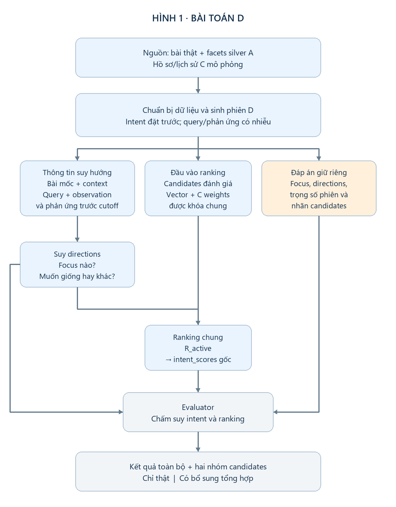
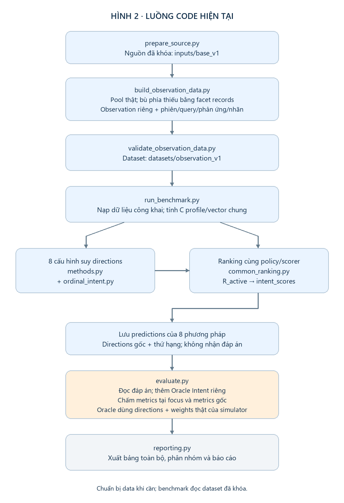

# Thực nghiệm D — hiểu bài toán và đọc kết quả

**Một benchmark · tám phương pháp · một bảng kết quả chính.** Oracle là mốc dùng đáp án ẩn. Các phân nhóm là cách đọc thêm cùng kết quả, không phải các thực nghiệm mới.

## 1. D kiểm tra điều gì?

- **Query/phản ứng có giúp suy nhu cầu giống–khác không?**
- **Nhu cầu suy được có giúp xếp bài phù hợp lên trên không?**

Ví dụ: đang đọc bài về **gợi ý bài báo khi thiếu lịch sử người dùng**. Context là task “gợi ý bài báo”; focus là problem. Muốn **giống problem** thì ưu tiên bài cũng xử lý thiếu lịch sử; muốn **khác problem** thì ưu tiên bài xử lý problem khác nhưng vẫn cùng task.

## 2. Dữ liệu và hình tổng quát

- **Candidates:** những bài cần xếp hạng. Ưu tiên bài thật, tổng hợp phía còn thiếu.
- **Observation:** các cặp riêng để tạo phản ứng trước cutoff; tách khỏi candidates đánh giá.
- **Hidden intent/labels:** simulator đặt nhu cầu và nhãn trước; chỉ evaluator/Oracle được dùng làm đáp án.

Bộ `datasets/observation_v1` có **19 thiết kế trên 12 bài mốc**. Mỗi thiết kế tạo 2 hướng × 3 chế độ query → **114 phiên**; lặp với 3 seeds × 2 mức nhiễu phản ứng.

**15 thiết kế** dùng pool 20 candidates thật; **4 thiết kế** dùng 19 thật + 1 tổng hợp. “4” là số thiết kế, không phải cả nhóm chỉ có bốn bài. Observation/query/phản ứng vẫn là mô phỏng ở cả hai nhóm.

Mỗi pool có một candidate đúng context và đúng hướng (**grade 2**), một candidate đúng context nhưng sai hướng (**grade 1**) và 18 bài ngoài context (**grade 0**). Hai nhu cầu đối lập giữ cùng pool.

## 3. Code chạy và phương pháp khác nhau ở đâu?

**Các phương pháp thay phần suy directions:**

- **Bốn baseline gốc:** fixed_similar (luôn giống, weights đều), profile_similar (luôn giống, weights C), DELTA (chỉ phản ứng), DELTA + query.
- **Đối chứng bổ sung:** QUERY-ONLY, VOTE, BAYES-H và Ordinal-Intent. Tất cả không train.
- **Oracle Intent:** evaluator dùng directions và trọng số phiên đúng; không phải phương pháp thực tế để chọn thắng.

DELTA lấy chênh lệch phản ứng **phía khác − phía giống**. Tổng chênh lệch chia cho `(số cặp + 2)`; đủ hai cặp và độ lớn ≥ 0,25 thì suy hướng. Dương → different, âm → similar; chưa rõ → unknown. DELTA + query bổ sung quy tắc query rõ.

**Ranking chung gồm hai bước:**

1. **R_active:** suy được duy nhất một focus → giữ context/focus, bỏ facet khác; chưa rõ → fallback always-similar. Không dùng focus thật.
2. **intent_scores gốc:** similarity cosine là S; similar dùng S, different dùng 1−S. Điểm là **Σ(weight × term) / Σweight** trên facets đang dùng. Không đạt context hoặc candidate thiếu facet active có weight → −1; anchor thiếu thì bỏ facet; hết weights dùng cosine context; hòa theo ID.

Ví dụ weights task/problem = 0,6/0,4: A có cosine (0,90; 0,95), B có (0,85; 0,20). Muốn giống problem: A=0,92 > B=0,59. Muốn khác: B=0,83 > A=0,56. **Đổi hướng làm đổi thứ tự.**

Vectors/candidates dùng chung; ngoài fixed_similar, các method dùng cùng C weights. Directions ban đầu được giữ để chấm: fallback ranking không được tính là suy đúng hướng.

## 4. Một bảng kết quả

| Phương pháp | Accuracy | F1 | Coverage | nDCG@10 | C@5 | C@10 |
|---|---:|---:|---:|---:|---:|---:|
| fixed_similar | 50,00% | 0,3333 | 100,00% | 0,8029 | 0,1722 | 0,0903 |
| profile_similar | 50,00% | 0,3333 | 100,00% | 0,8019 | 0,1722 | 0,0903 |
| QUERY-ONLY | 33,33% | 0,5000 | 33,33% | 0,8623 | 0,1815 | 0,0935 |
| DELTA | 95,83% | 0,9734 | 96,80% | 0,9597 | 0,1981 | 0,0993 |
| **DELTA + query** | 96,91% | 0,9793 | 97,84% | 0,9632 | 0,1985 | 0,0995 |
| VOTE | 91,74% | 0,9545 | 92,05% | 0,9523 | 0,1962 | 0,0988 |
| BAYES-H | 91,51% | 0,9533 | 91,82% | 0,9518 | 0,1962 | 0,0988 |
| Ordinal-Intent | 81,13% | 0,8934 | 81,13% | 0,9374 | 0,1940 | 0,0979 |
| Oracle — đặc quyền | 100,00% | 1,0000 | 100,00% | 0,9862 | 0,2000 | 0,1000 |

**Đọc cột:** Accuracy/F1/Coverage chấm tại focus; unknown tính sai trong accuracy. nDCG đo thứ hạng, không phải phần trăm đoán đúng. C@K là Compliance@K = số grade 2 trong top K / K; một grade 2/phiên nên trần C@5=0,20 và C@10=0,10.

Bảng dùng trung bình theo thiết kế rồi nhóm bài mốc. Metrics gốc tính cả context + focus và toàn bộ Recall/Precision/MRR được giữ trong [báo cáo đầy đủ](results/benchmark_complete_20261021_01/report.md); không trộn hai định nghĩa vào bảng này.

## 5. Nói được gì từ bảng này?

- **Phản ứng giúp suy hướng:** DELTA 95,83% so với mốc luôn similar 50%. Thêm query tăng lên **96,91%**.
- **Intent giúp ranking:** DELTA + query có nDCG **0,9632** so với profile_similar **0,8019**, và đưa bài đúng nhu cầu lên hạng 1 ở **94,56%** phiên. Hiệu quả bao gồm suy scope và hướng.
- **DELTA + query gốc vẫn tốt nhất trong tám phương pháp.** Các method bổ sung chưa thắng. Oracle dùng đáp án ẩn nên được đọc riêng.

Chỉ xét nhóm candidates thật, nDCG cũng tăng **0,7537 → 0,9483**. Đây là phân nhóm từ cùng lượt chạy, không cần thêm một bảng thực nghiệm trong bản ngắn.

**Phạm vi:** kết quả hỗ trợ hai luận điểm trong mô phỏng có kiểm soát. Chỉ 12 bài mốc, query/cặp khá thuận lợi và phần lớn candidates ngoài context; chưa xác nhận trên người dùng thật hoặc test nội dung độc lập.

Nguồn: [lượt chạy complete](results/benchmark_complete_20261021_01/report.md), 5.472 public predictions + 684 Oracle. Chạy lại từ thư mục experiments bằng `python -B scripts/exp_d/proposal/run_benchmark.py`.
