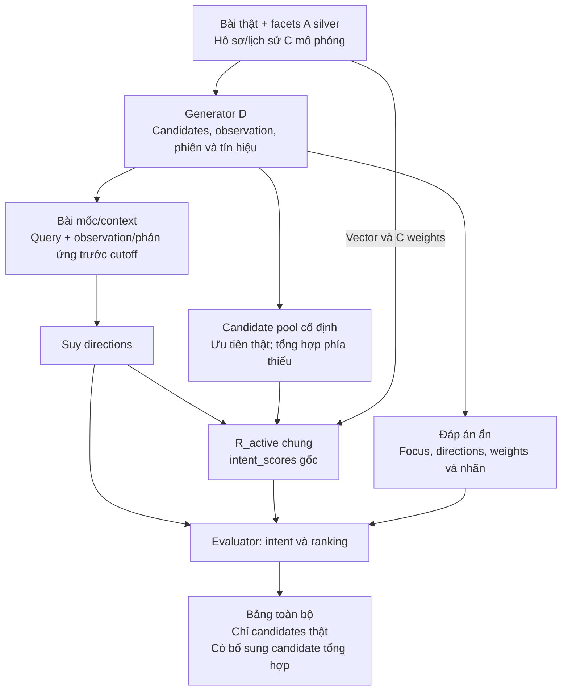
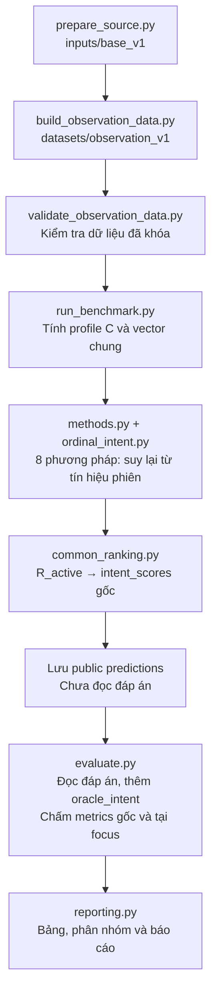

# Thực nghiệm D — suy nhu cầu phiên và xếp hạng bài báo

## 1. Hai câu hỏi cần kiểm tra

| Câu hỏi | Phép so |
|---|---|
| Query/phản ứng có giúp suy hướng không? | Không tín hiệu phiên / chỉ query / chỉ phản ứng / kết hợp |
| Intent suy được có giúp ranking không? | Các dự đoán đi qua cùng policy và scorer |

Ví dụ: giữ task gợi ý bài báo, tìm cùng hoặc khác problem so với bài mốc. Context được cung cấp; focus và hướng phải suy từ tín hiệu.

## 2. Hình 1 — bài toán tổng quát



Đáp án ẩn chỉ đi vào evaluator. Observation tách khỏi candidates; estimator không nhận danh sách candidate pool đánh giá.

## 3. Dữ liệu đang dùng

| Thành phần | Nguồn và vai trò |
|---|---|
| Bài mốc/candidates thật | Corpus hiện có; facets silver A đã lọc |
| Trọng số cá nhân | Tính lại từ prefix lịch sử C mô phỏng, khóa trước so sánh |
| Candidate tổng hợp | Bản ghi facet ghép có ghi nguồn; chỉ bù phía còn thiếu |
| Observation/query/phản ứng | D mô phỏng; observation riêng, phản ứng có nhiễu |
| Nhãn và intent | Generator đặt trước; chỉ evaluator/oracle dùng |

| Nhóm candidates | Số thiết kế | Số phiên | Thành phần mỗi pool |
|---|---:|---:|---|
| Chỉ candidates thật | 15 | 90 | 20 thật |
| Có bổ sung tổng hợp | 4 | 24 | 19 thật + 1 tổng hợp |
| Toàn bộ | 19 | 114 | 20 candidates/phiên |

Nhóm có bổ sung gồm 4 thiết kế, với 4 candidate tổng hợp duy nhất; không có bộ chỉ gồm candidates tổng hợp.
19 thiết kế trên 12 bài mốc × 2 hướng × 3 chế độ query = 114 phiên; 4 cặp observation/phiên. Mỗi pool: một candidate grade 2, một grade 1 và 18 grade 0.
3 seeds × 2 mức Gaussian noise [0.2, 0.5] là các lần lặp trên cùng nội dung, không phải người dùng/nội dung độc lập mới.
Dataset: `data\exp_d\proposal\datasets\observation_v1`. Nguồn cào thêm ngoài corpus không dùng.

## 4. Hình 2 — luồng hiện thực chạy từ đầu



Runner chạy từ dataset đã khóa, không đọc kết quả cũ. Hai bước chuẩn bị nguồn/sinh dataset chỉ cần chạy khi chủ động đổi dữ liệu, không tự sinh lại trong mỗi benchmark.

## 5. Phương pháp và ranking

| Phương pháp | Cách suy |
|---|---|
| fixed_similar — gốc | Luôn similar, trọng số đều |
| profile_similar — gốc | Luôn similar, trọng số C |
| direction_behavior / DELTA — gốc | Chênh lệch phản ứng phía khác − phía giống |
| direction_search / DELTA+query — gốc | DELTA + quy tắc query gốc |
| query_only | Chỉ query |
| vote | Dấu phiếu phản ứng + query |
| bayes_h | Posterior từ dấu phản ứng + query |
| ordinal_intent | Posterior từ mức chênh lệch, kể cả hòa + query |
| oracle_intent — đặc quyền | Đáp án directions VÀ trọng số phiên; không phải đối thủ thực tế |

Tất cả public methods không train, dùng chung candidates/vector; trừ fixed_similar, đều dùng cùng C weights. Không chọn lại tham số theo điểm lượt này.
R_active: có duy nhất một focus suy được → context/focus hoạt động, facet khác ignore; chưa rõ → fallback always-similar đã công bố. Directions gốc vẫn giữ để chấm intent.

### Scorer tính thế nào?

| Bước | Quy tắc intent_scores gốc |
|---|---|
| Context gate | Thiếu context hoặc cosine ≤ 0: score −1 |
| Similarity | S_f là cosine TF-IDF concept text từng facet, trong [0,1] |
| Đổi theo hướng | similar/unknown: T_f=S_f; different: T_f=1−S_f; ignore: bỏ facet |
| Tổng hợp | score = Σ(w_f × T_f) / Σw_f trên các facet đang dùng |
| Thiếu facet | Candidate thiếu facet active có weight: −1; anchor thiếu: bỏ facet đó |
| Fallback/hòa | Hết weights: cosine context; hòa điểm: theo ID |

| Ví dụ context/problem weight .6, focus/method .4 | S_problem | S_method | Muốn giống method | Muốn khác method |
|---|---:|---:|---:|---:|
| A | .90 | .95 | .92 | .56 |
| B | .85 | .20 | .59 | .83 |
Đổi direction làm đổi ưu tiên A/B. Nhãn relevance dùng concept overlap, không dùng score làm đáp án.

## 6. Kết quả chính — trung bình theo nhóm bài mốc

| Method | Accuracy focus | F1 focus | Coverage focus | nDCG@10 | Grade-2@1 |
|---|---:|---:|---:|---:|---:|
| fixed_similar | 50.00% | 0.3333 | 100.00% | 0.8029 | 50.00% |
| profile_similar | 50.00% | 0.3333 | 100.00% | 0.8019 | 50.00% |
| query_only | 33.33% | 0.5000 | 33.33% | 0.8623 | 66.44% |
| direction_behavior | 95.83% | 0.9734 | 96.80% | 0.9597 | 93.63% |
| direction_search | 96.91% | 0.9793 | 97.84% | 0.9632 | 94.56% |
| vote | 91.74% | 0.9545 | 92.05% | 0.9523 | 91.59% |
| bayes_h | 91.51% | 0.9533 | 91.82% | 0.9518 | 91.36% |
| ordinal_intent | 81.13% | 0.8934 | 81.13% | 0.9374 | 87.00% |
| oracle_intent (đặc quyền) | 100.00% | 1.0000 | 100.00% | 0.9862 | 100.00% |

Unknown tính sai; accuracy/coverage tại focus thật do evaluator chấm. Context cho sẵn không tính vào thành tích bảng chính. F1 từ confusion theo thiết kế trong mỗi nhóm anchor rồi lấy trung bình nhóm.
Oracle dùng đúng directions và weights ẩn như README gốc; không đưa vào chọn method tốt nhất, không là trần toán học. Đặc quyền được lưu riêng trong oracle_predictions.jsonl.

### Các độ đo gốc — định nghĩa và tổng hợp gốc

| Method | F1 context+focus | Accuracy context+focus | Coverage context+focus | Compliance@5 | Compliance@10 | Importance MAE |
|---|---:|---:|---:|---:|---:|---:|
| fixed_similar | 0.4286 | 75.00% | 100.00% | 0.1737 | 0.0895 | 0.2400 |
| profile_similar | 0.4286 | 75.00% | 100.00% | 0.1737 | 0.0895 | 0.2328 |
| query_only | 0.6875 | 66.67% | 66.67% | 0.1825 | 0.0930 | 0.2328 |
| direction_behavior | 0.9815 | 97.88% | 98.46% | 0.1985 | 0.0996 | 0.2328 |
| direction_search | 0.9868 | 98.46% | 98.98% | 0.1988 | 0.0997 | 0.2328 |
| vote | 0.9702 | 95.91% | 96.05% | 0.1974 | 0.0991 | 0.2328 |
| bayes_h | 0.9694 | 95.83% | 95.98% | 0.1974 | 0.0991 | 0.2328 |
| ordinal_intent | 0.9256 | 90.20% | 90.20% | 0.1947 | 0.0980 | 0.2328 |
| oracle_intent | 1.0000 | 100.00% | 100.00% | 0.2000 | 0.1000 | 0.0000 |

Bảng này gọi evaluator/aggregate gốc: trung bình case-condition và F1 gộp confusion context+focus. Vì khác phạm vi/đơn vị tổng hợp, không so trực tiếp accuracy với bảng focus ở trên.
Ví dụ always-similar: accuracy focus 50%, context+focus 75%. Đây là khác định nghĩa, không phải method đổi.
Compliance@K = số grade 2 trong top K / K. Một grade 2/phiên → trần @5=.20, @10=.10; không diễn giải .10 là chỉ đạt 10% khả năng tối đa.

### Retrieval theo quy tắc gốc

| Method | nDCG@5 | nDCG@10 | Recall@5 / @10 | Precision@5 / @10 | MRR@5 / @10 |
|---|---:|---:|---:|---:|---:|
| fixed_similar | 0.7940 | 0.8027 | 0.8684 / 0.8947 | 0.3474 / 0.1789 | 1.0000 / 1.0000 |
| profile_similar | 0.7902 | 0.7989 | 0.8684 / 0.8947 | 0.3474 / 0.1789 | 1.0000 / 1.0000 |
| query_only | 0.8474 | 0.8573 | 0.8904 / 0.9298 | 0.3561 / 0.1860 | 1.0000 / 1.0000 |
| direction_behavior | 0.9440 | 0.9571 | 0.9276 / 0.9942 | 0.3711 / 0.1988 | 0.9890 / 0.9890 |
| direction_search | 0.9467 | 0.9599 | 0.9291 / 0.9963 | 0.3716 / 0.1993 | 0.9890 / 0.9890 |
| vote | 0.9381 | 0.9514 | 0.9254 / 0.9927 | 0.3702 / 0.1985 | 0.9898 / 0.9898 |
| bayes_h | 0.9378 | 0.9511 | 0.9254 / 0.9927 | 0.3702 / 0.1985 | 0.9898 / 0.9898 |
| ordinal_intent | 0.9211 | 0.9334 | 0.9181 / 0.9788 | 0.3673 / 0.1958 | 0.9915 / 0.9915 |
| oracle_intent | 0.9851 | 0.9901 | 0.9737 / 1.0000 | 0.3895 / 0.2000 | 1.0000 / 1.0000 |

Recall/Precision/MRR gốc nhận cả grade 1 và 2 là positive; candidate sai hướng vẫn có thể làm những chỉ số này cao. Vì vậy cần đọc cùng nDCG, Grade-2@1 và Compliance.

### Phân nhóm candidates — cùng lượt chạy

| Nhóm | Thiết kế / phiên | nDCG profile_similar | nDCG DELTA+query | nDCG Oracle |
|---|---:|---:|---:|---:|
| Toàn bộ | 19 / 114 | 0.8019 | 0.9632 | 0.9862 |
| Chỉ candidates thật | 15 / 90 | 0.7537 | 0.9483 | 0.9839 |
| Có bổ sung tổng hợp | 4 / 24 | 0.8984 | 0.9929 | 0.9910 |

Các nhóm khác focus/context nên không dùng chênh lệch giữa nhóm để quy tác động nhân quả cho tổng hợp. “Chỉ candidates thật” vẫn dùng observation và phản ứng mô phỏng.

## 7. Kết luận và giới hạn

| Phép so | Chỉ số | Chênh lệch | Khoảng paired 95% theo anchor |
|---|---|---:|---:|
| reaction_vs_no_signal | direction_accuracy | +0.4583 | [+0.4321; +0.4776] |
| query_added_to_reactions | direction_accuracy | +0.0108 | [+0.0039; +0.0185] |
| directions_vs_no_signal | ndcg10 | +0.1613 | [+0.1081; +0.2159] |
| ordinal_vs_delta | direction_accuracy | -0.1578 | [-0.1860; -0.1300] |
| ordinal_vs_delta | ndcg10 | -0.0257 | [-0.0373; -0.0162] |

Phương pháp public tốt nhất trên pilot: direction_search theo nDCG; direction_search theo accuracy hướng.
Phản ứng/query và intent-aware ranking được đánh giá trong mô phỏng. Phép so với no-signal bao gồm suy scope lẫn dấu hướng; không quy toàn bộ lợi ích cho riêng dấu similar/different.
12 anchors, query/cặp có kiểm soát và 18 candidates ngoài context khiến phép thử thuận lợi. Chưa là kiểm chứng trên người dùng hoặc nội dung độc lập; không khẳng định novelty chỉ vì một baseline đứng đầu.
Đã chạy lại từ đầu: 5,472 public predictions + 684 oracle predictions. Không đọc prediction cache cũ, không sinh lại dataset, không tune ngưỡng.

## 8. Đọc kết quả và tái lập

| Tệp | Nội dung |
|---|---|
| summary.csv / groups.csv | Tất cả chỉ số theo thiết kế/anchor; nhóm thật/tổng hợp, query, noise, focus, direction |
| legacy_summary.csv / legacy_groups.csv | Đúng cách tính/tổng hợp gốc |
| predictions.jsonl | 8 phương pháp public; directions trước adapter, ranking sau adapter và legacy_ranking để audit |
| oracle_predictions.jsonl | Riêng evaluator; true session weights và directions |
| details.jsonl / metric_definitions.json | Chỉ số từng phiên và định nghĩa |
| baseline_parity.json | Cả bốn baseline khớp runner gốc trên mọi phiên/condition trước policy mới |
| paired_comparisons.csv / conclusions.json | Phép so paired, bootstrap và phạm vi kết luận |
| config.json / protocol.md / manifest.json | Tham số trước chạy, kế hoạch, hashes và trạng thái |

Chạy từ thư mục experiments:

```powershell
python -B scripts/exp_d/proposal/run_benchmark.py
```

Mỗi lượt tự chọn output mới; manifest.status=complete xác nhận hoàn tất. Không cần chạy lần lượt các runner lịch sử.
