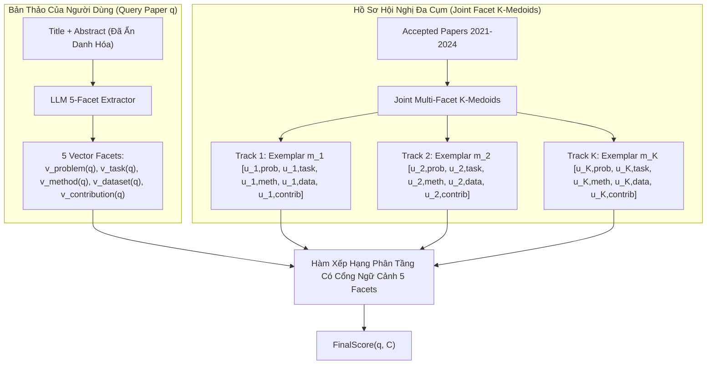
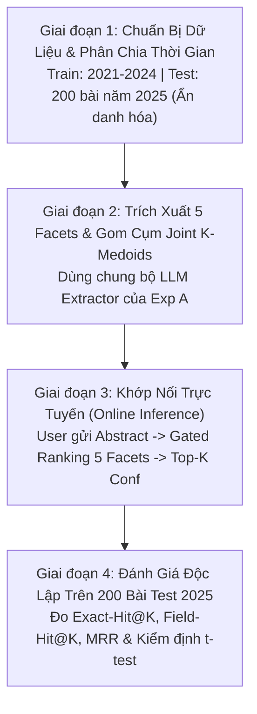
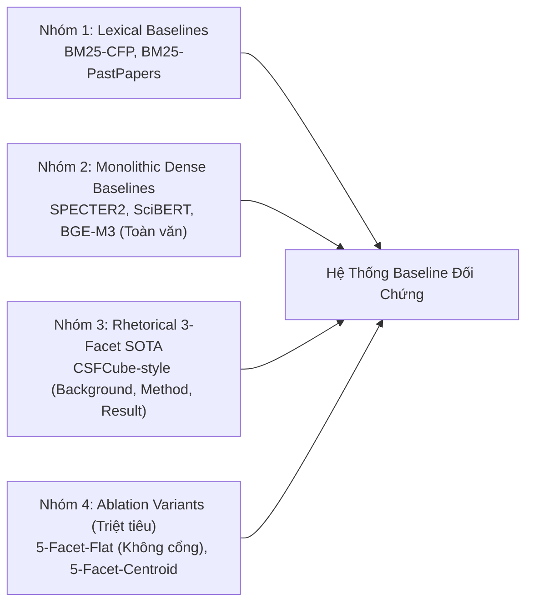

# TÀI LIỆU TOÀN DIỆN: PHÂN HỆ KHUYẾN NGHỊ HỘI NGHỊ KHOA HỌC (CONFERENCE RECOMMENDATION)
## DỰA TRÊN HỆ BIỂU DIỄN 5 FACETS VÀ MÔ HÌNH HÓA ĐA CỤM NGỮ CẢNH (DS300)

> **Người thực hiện:** Kiên  
> **Mục tiêu:** Cung cấp nền tảng lý thuyết toán học trực quan, kiến trúc kỹ thuật đồng bộ trên 5 facets, thuật toán gom cụm liên kết (Joint Facet $K$-Medoids), quy trình phân chia dữ liệu thực nghiệm (Train 2021–2024, Test 2025), hệ thống baseline đối chứng toàn diện và ma trận benchmark đa mô hình trích xuất phục vụ báo cáo và công bố khoa học.

---

Kiểm chứng giả thuyết: *Liệu chất lượng trích xuất facet của LLM có tỷ lệ thuận tuyến tính với độ chính xác khi gợi ý hội nghị hay không?*


## 1. TỔNG QUAN (OVERVIEW)

### 1.1. Đặt Vấn Đề (Problem Statement)
Trong nghiên cứu khoa học, việc chọn sai hội nghị để nộp bài (Desk Reject do lệch Scope / Aims & Topics) gây lãng phí từ 3 đến 6 tháng của tác giả.  
Bài toán **Conference Recommendation** được định nghĩa như sau:  
* **Đầu vào (Input):** Tiêu đề và Tóm tắt (Title + Abstract) của một bài báo bản thảo mới $q$.
* **Đầu ra (Output):** Danh sách xếp hạng Top-$K$ hội nghị phù hợp nhất $C_1, C_2, \dots, C_K$ kèm lý giải định lượng theo từng khía cạnh tri thức.

### 1.2. Tại Sao Các Phương Pháp Truyền Thống Thất Bại?
1. **So khớp từ vựng dựa trên Call for Papers (CFP):** Các phương pháp từ vựng truyền thống (BM25, TF-IDF) thất bại do mức độ trùng lặp từ vựng nghiêm trọng và tính khái quát quá cao trong danh mục chủ đề CFP giữa các hội nghị khác nhau. Sự bão hòa từ khóa làm triệt tiêu năng lực phân tách cần thiết để nắm bắt được đặc trưng và định hướng nghiên cứu chuyên biệt của từng venue.
2. **Tiếp cận dựa trên mạng lưới đồ thị trích dẫn (Citation Network):** Bản thảo mới viết xong chưa hề có trích dẫn (Zero-citation cold-start), hoàn toàn không thể liên kết vào đồ thị trích dẫn hay mạng lưới đồng tác giả.
3. **Biểu diễn toàn bài dày đặc nguyên khối (Monolithic Embeddings - SciBERT, SPECTER):** Gây ra hiện tượng vướng víu ngữ nghĩa khi cố gắng nén toàn bộ các khía cạnh cấu trúc dị biệt (bài toán cốt lõi, phương pháp luận, thiết lập thực nghiệm, đóng góp mới) vào một không gian vector phẳng duy nhất. Cơ chế này xóa nhòa ranh giới giữa miền ứng dụng và giải pháp kỹ thuật, yếu tố tiên quyết để căn chỉnh độ tương thích chính xác với từng hội nghị mục tiêu.

### 1.3. Hướng Tiếp Cận 5 Facets Chuẩn Hóa
Hệ thống phân rã bản thảo $q$ thành 5 thành phần cấu trúc độc lập:
$$\mathbf{V}(q) = \big[ \mathbf{v}_{\text{problem}}(q), \mathbf{v}_{\text{task}}(q), \mathbf{v}_{\text{method}}(q), \mathbf{v}_{\text{dataset}}(q), \mathbf{v}_{\text{contribution}}(q) \big]$$

Hội nghị được biểu diễn thành một tập hợp các không gian con đa khía cạnh được sinh ra từ lịch sử các bài báo được chấp nhận. Bằng cách phân rã bài báo thành **5 facets độc lập**:
* **`problem`**: Xác định bài toán vĩ mô có thuộc phạm vi quan tâm cốt lõi của hội nghị hay không (Relevance Gatekeeper).
* **`task`**: Căn chỉnh mục tiêu kỹ thuật / nhiệm vụ thao tác (Link Prediction, Text Generation, v.v.).
* **`method`**: Đo lường sự tương thích về mặt giải thuật, kiến trúc kỹ thuật mà cộng đồng hội nghị ưa chuộng.
* **`dataset`**: Kiểm chứng quy mô và miền dữ liệu thực nghiệm (Benchmark alignment).
* **`contribution`**: Đánh giá bản chất giá trị thặng dư (Đóng góp lý thuyết, Cải tiến thuật toán, hay Ứng dụng thực tiễn/Hệ thống) có khớp với khẩu vị học thuật của hội nghị hay không.

---

## 2. KIẾN TRÚC CHÍNH (MAIN ARCHITECTURE)



### 2.1. Biểu Diễn Hội Nghị Bằng "Gom Cụm Liên Kết Đa Khía Cạnh" (Joint Facet $K$-Medoids Profiling)
Một hội nghị lớn như KDD hoặc NeurIPS bao trùm nhiều phân ngành nghiên cứu khác nhau. Để tránh hiện tượng lấy trung bình toàn bộ hội nghị làm mất đặc trưng (Centroid Collapse), hệ thống mô hình hóa mỗi hội nghị $C$ thành $K$ cụm chủ đề (Tracks) độc lập:
$$\mathcal{T}_C = \{T_{C, 1}, T_{C, 2}, \dots, T_{C, K}\}$$

#### Thuật toán Gom Cụm Liên Kết (Joint Clustering Protocol):
Để đảm bảo tính toàn vẹn học thuật và tránh tạo ra các cụm rời rạc không có thực ("Frankenstein Tracks"):
1. **Khoảng cách Đa khía cạnh giữa hai bài báo:** Khoảng cách giữa hai bài báo $p_i$ và $p_j$ được tính bằng khoảng cách tổng hợp có trọng số trên toàn bộ 5 facets:
   $$\mathcal{D}(p_i, p_j) = 1 - \sum_{f \in \text{FACETS}} \beta_f \cdot \cos\big(\mathbf{v}_f(p_i), \mathbf{v}_f(p_j)\big)$$
   *(Với $\sum \beta_f = 1.0$).*
2. **Chọn Bài Báo Tiêu Biểu Làm Tâm Cụm (Exemplar Papers):** Thuật toán $K$-Medoids lựa chọn trực tiếp $K$ bài báo có thật $m_1, m_2, \dots, m_K \in D_C$ sao cho tổng khoảng cách $\mathcal{D}$ từ các bài báo trong cụm đến bài báo tâm là nhỏ nhất.
3. **Kế thừa Vector Đại diện:** Khi bài báo $m_k$ được chọn làm Medoid cho cụm $k$, **chính 5 vector facets của bài báo $m_k$** sẽ trở thành các vector đại diện cho cụm:
   $$\mathbf{u}_{C, k, f} = \mathbf{v}_f(m_k) \quad \forall f \in \{\text{problem}, \text{task}, \text{method}, \text{dataset}, \text{contribution}\}$$
   *Ý nghĩa:* Cơ chế này đảm bảo tính gắn kết tự nhiên $100\%$ giữa Problem, Method và Task trong cùng một track, phản ánh trung thực cấu trúc nghiên cứu thực tế của hội nghị.

### 2.2. Hàm Xếp Hạng Phân Tầng Có Cổng Ngữ Cảnh Đồng Bộ 5 Facets (Hierarchical Gated Ranking)
Điểm phù hợp giữa bài báo $q$ và hội nghị $C$ được tính toán phân tầng theo công thức:

$$\text{FinalScore}(q, C) = \max_{k \in \{1, \dots, K\}} \Big[ \mathcal{G}_{\text{problem}}(q, T_{C, k}) \times \sum_{f \in \{\text{task}, \text{method}, \text{dataset}, \text{contribution}\}} \tilde{w}_f \cdot \cos\big(\mathbf{v}_f(q), \mathbf{u}_{C, k, f}\big) \Big]$$

#### Cơ chế hoạt động chi tiết:
1. **Toán tử $\max_{k}$ (Track Alignment):** Bản thảo của tác giả được đối chiếu với từng cụm chuyên môn, chỉ cần đạt độ tương thích vượt trội với **đúng 1 track** của hội nghị (ví dụ: bài NLP nộp vào KDD chỉ cần khớp với Track *Text Mining*, không bị kéo tụt điểm bởi các track *Computer Vision* hay *Graph Mining*).
2. **Cổng Ngữ cảnh $\mathcal{G}_{\text{problem}}$ (The Gatekeeper):**
   $$\mathcal{G}_{\text{problem}}(q, T_{C, k}) = \sigma\Big(\kappa \cdot \big(\cos(\mathbf{v}_{\text{problem}}(q), \mathbf{u}_{C, k, \text{problem}}) - \tau\big)\Big)$$
   * Nếu bài toán vĩ mô của bản thảo nằm ngoài phạm vi quan tâm của track ($\cos < \tau$), hàm Sigmoid $\sigma$ sẽ nhanh chóng triệt tiêu giá trị $\mathcal{G}_{\text{problem}}$ về tiệm cận **$0$**.
   * Cổng này bảo đảm tính tương thích chủ đề tiên quyết: một bài báo về "Chẩn đoán bệnh lý" dù có sử dụng phương pháp GNN tiên tiến cũng sẽ không bị gợi ý vào hội nghị thuần về "Lý thuyết Mạng máy tính".
3. **Chuẩn Hóa Trọng Số Động Cho Các Facets Còn Lại (Dynamic Weight Re-normalization):**  
   Khi bài báo bị khuyết một facet trong Abstract (ví dụ không nêu tên dữ liệu cụ thể $\mathbf{v}_{\text{dataset}} = \emptyset$), hệ thống tự động tái chuẩn hóa trọng số trên tập các facets quan sát được ($\mathcal{F}_{\text{observed}}$):
   $$\tilde{w}_f = \frac{w_f}{\sum_{g \in \mathcal{F}_{\text{observed}}} w_g} \quad \forall f \in \mathcal{F}_{\text{observed}}$$
   * Trọng số định sẵn: $w_{\text{task}} = 0.3, w_{\text{method}} = 0.3, w_{\text{dataset}} = 0.2, w_{\text{contribution}} = 0.2$ ($\sum = 1.0$).
   * Trọng số của facet rỗng được phân bổ đều lại cho các facet còn lại, bảo đảm tổng điểm luôn chuẩn hóa trên thang đo $[0, 1]$.

### 2.3. Hiệu Chuẩn Siêu Tham Số Trên Tập Validation (Hyperparameter Calibration)
Để đảm bảo tính khách quan học thuật, các siêu tham số không bị gán cứng cảm tính mà được chuẩn hóa thông qua thực nghiệm trên tập Dev (Validation):
* **Số cụm chủ đề $K$:** Xác định thông qua hệ số phân tách cụm **Silhouette Coefficient** trên tập Train ($K \in [3, 8]$, mặc định chọn $K = 5$).
* **Ngưỡng cắt $\tau$ và độ dốc $\kappa$ của Cổng Ngữ Cảnh:** Tối ưu hóa bằng Grid Search trên không gian $\tau \in [0.4, 0.7]$ và $\kappa \in [5, 15]$ nhằm tối đa hóa chỉ số nDCG@5 trên tập kiểm định trước khi cố định đánh giá trên tập Test.

---

## 3. THIẾT LẬP DỮ LIỆU & PHÂN CHIA THỜI GIAN (DATASET & TEMPORAL SPLIT)

Để đảm bảo chuẩn mực học thuật quốc tế và loại bỏ hoàn toàn nguy cơ rò rỉ dữ liệu (Zero Data Leakage), tập dữ liệu hội nghị được thu thập và phân chia nghiêm ngặt theo mốc thời gian xuất bản:

```
[TOÀN BỘ CORPUS HỘI NGHỊ]
  ├── TẬP HUẤN LUYỆN & HỒ SƠ (TRAIN / PROFILING SET: 2021 – 2024)
  │     ├── Nguồn: Các bài báo accepted tại 16 hội nghị mục tiêu
  │     ├── Nhiệm vụ: Chạy LLM Extractor trích xuất 5 facets -> Gom Joint K-Medoids tạo Track Profiles
  │     └── Nguyên tắc: Tuyệt đối đóng băng, không chứa bài báo nào từ năm 2025
  │
  └── TẬP ĐÁNH GIÁ ĐỘC LẬP (TEST SET: NĂM 2025)
        ├── Quy mô: Đúng 200 bài báo xuất bản mới nhất trong năm 2025 (tại cùng 16 hội nghị)
        ├── Tiền xử lý: Ẩn danh hóa hoàn toàn (xóa tác giả, trường viện, link ngoài)
        ├── Ground-truth tự nhiên: Tên hội nghị thực tế đã chấp nhận bài báo (Natural Publication Label)
        └── Nhiệm vụ: Đưa Abstract vào hệ thống -> Đo lường các chỉ số Hit@K, Field-Hit@K và MRR
```

### 3.1. Danh Mục Hội Nghị Mục Tiêu (Target Conference Catalog)
Hệ thống chọn lọc 16 hội nghị đầu ngành (Rank A/A* theo CORE Ranking) phân bổ đều trên 4 phân ban chuyên ngành chính của Khoa học máy tính:

| Phân ban chuyên ngành (Field Cluster $\mathcal{S}$) | Danh mục Hội nghị Mục tiêu (Venues) |
|---|---|
| **AI & Machine Learning** | NeurIPS, ICML, ICLR, AAAI |
| **NLP & Computational Linguistics** | ACL, EMNLP, NAACL, COLING |
| **Data Mining & Information Retrieval** | KDD, SIGIR, CIKM, RecSys |
| **Computer Vision & Multimedia** | CVPR, ICCV, ECCV, ACM MM |

### 3.2. Thu Thập Dữ Liệu & Quy Tắc Ẩn Danh Hóa (Blinded Input)
* **Nguồn dữ liệu:** DBLP, OpenAlex, Semantic Scholar API, OpenReview.
* **Tập Train (2021–2024):** Thu thập toàn bộ bài báo accepted của 16 hội nghị trong 4 năm để xây dựng hồ sơ $K$-Medoids ổn định.
* **Tập Test (2025):** Lấy ngẫu nhiên có phân tầng đúng **200 bài báo xuất bản năm 2025** phân bổ đều trên 16 hội nghị (~12–13 bài/hội nghị).
* **Quy tắc Ẩn danh hóa Tuyệt đối (Blinded Input):** Trước khi đưa tập Test vào suy luận, toàn bộ thông tin về tác giả, trường viện, liên kết GitHub và các câu tự trích dẫn được loại bỏ hoàn toàn. Điều này bảo đảm LLM chỉ trích xuất các thành phần ngữ nghĩa thuần túy từ văn bản, ngăn ngừa nguy cơ LLM học vẹt tên hội nghị từ dữ liệu tiền huấn luyện.

---

## 4. QUY TRÌNH THỰC THI (STEP-BY-STEP PIPELINE)

Quy trình vận hành gồm 4 giai đoạn độc lập:



### Bước 1: Thu Thập & Phân Tách Dữ Liệu Chống Rò Rỉ
* Các bài báo $\le 2024$ được đưa vào Train Set; đúng 200 bài công bố năm $2025$ được tách riêng làm Test Set.
* Áp dụng quy tắc ẩn danh hóa trên toàn bộ 200 bài test.

### Bước 2: Trích Xuất 5 Facets & Gom Cụm Liên Kết (Profiling)
* Với mỗi bài báo trong Train Set (2021–2024), gọi bộ LLM Extractor để trích xuất đủ 5 facets: `problem`, `task`, `method`, `dataset`, `contribution`.
* Mã hóa các cụm từ facet thành dense vector bằng mô hình embedding cố định (ví dụ: `Qwen3-Embedding-0.6B` hoặc `SPECTER2`).
* Áp dụng thuật toán Joint Facet $K$-Medoids ($K = 5$) cho từng hội nghị để chọn 5 bài báo đại diện cho 5 track.

### Bước 3: Khuyến Nghị & Sinh Giải Thích Đầy Đủ 5 Facets
Khi người dùng tải bản thảo lên:
1. LLM Extractor trích 5 facets của bản thảo trong $\approx 1$ giây.
2. Áp dụng chuẩn hóa trọng số động nếu có facet bị khuyết.
3. Tính $\text{FinalScore}(q, C)$ cho toàn bộ 16 hội nghị theo công thức cổng phân tầng.
4. Xuất danh sách Top-$K$ kèm thẻ giải thích minh bạch:
   * *Hội nghị SIGIR:* Khớp 92% Problem (Neural Search), 89% Task (Dense Retrieval), 87% Method (Contrastive Learning), 85% Dataset (MS MARCO), 82% Contribution (Latency reduction).

### Bước 4: Đánh Giá Độc Lập
Đo lường hiệu năng của toàn bộ hệ thống trên 200 bài test năm 2025 qua hệ thống thước đo định lượng và kiểm định ý nghĩa thống kê.

---

## 5. HỆ THỐNG BASELINE ĐỐI CHỨNG (BASELINE BENCHMARK SUITE)

Để chứng minh tính vượt trội của kiến trúc 5 Facets đề xuất theo chuẩn mực IEEE/ACM, hệ thống được so sánh toàn diện với **4 nhóm phương pháp nền tảng**:



### 5.1. Nhóm 1: Mô Hình Từ Vựng Truyền Thống (Lexical Baselines)
1. **`BM25-CFP`:** Sử dụng thuật toán BM25 so khớp từ khóa giữa bản thảo người dùng và văn bản Call for Papers chính thức của hội nghị.
2. **`BM25-PastPapers`:** Sử dụng BM25 so khớp bản thảo với toàn bộ kho bài báo lịch sử (2021–2024) của hội nghị và lấy điểm trung bình Top-10 bài tương đồng nhất.

### 5.2. Nhóm 2: Mô Hình Biểu Diễn Toàn Văn Dày Đặc (Monolithic Dense Semantic Baselines)
3. **`SPECTER2-FullText`:** Sử dụng mô hình chuyên biệt cho văn bản khoa học `allenai/specter2` mã hóa toàn bộ Title + Abstract thành 1 vector 768 chiều duy nhất, tính độ tương đồng cosine với vector trung bình của các bài báo hội nghị.
4. **`SciBERT-FullText`:** Sử dụng checkpoint `allenai/scibert_scivocab_uncased` mã hóa toàn bài báo (Title + Abstract).
5. **`BGE-M3-FullText`:** Sử dụng mô hình nhúng đa ngôn ngữ và đa chức năng SOTA `BAAI/bge-m3` để biểu diễn toàn văn bản thảo.

### 5.3. Nhóm 3: Mô Hình Phân Khía Cạnh Hùng Biện 3 Facets (Rhetorical Facet Prior SOTA)
6. **`CSFCube-3Facets` (NeurIPS 2021 style):** Phân chia văn bản thành 3 khía cạnh truyền thống: *Background*, *Method*, *Result* và tính tổng tương đồng có trọng số. Baseline này dùng để chứng minh giá trị gia tăng của việc mở rộng sang 5 facets chuẩn IMRaD.

### 5.4. Nhóm 4: Các Biến Thể Triệt Tiêu Thành Phần (Ablation Variants of Proposed Model)
7. **`5-Facet-Centroid`:** Sử dụng đủ 5 facets nhưng biểu diễn hội nghị bằng 1 vector trung bình duy nhất cho mỗi facet (không gom cụm đa track), nhằm chứng minh tác dụng của cơ chế $K$-Medoids.
8. **`5-Facet-Flat` (Un-gated):** Sử dụng 5 facets và $K$-Medoids nhưng **không sử dụng Cổng Ngữ Cảnh** ($\mathcal{G}_{\text{problem}} = 1$), xếp hạng thuần túy bằng tổng tuyến tính nhằm chứng minh vai trò kiểm soát đề tài của Gatekeeper.
9. **`5-Facet-Gated-KMedoids` (Mô hình Đề xuất Hoàn chỉnh):** Tích hợp trọn vẹn Cổng Ngữ Cảnh $\mathcal{G}_{\text{problem}}$, Gom cụm liên kết Joint $K$-Medoids và Chuẩn hóa trọng số động.

---
