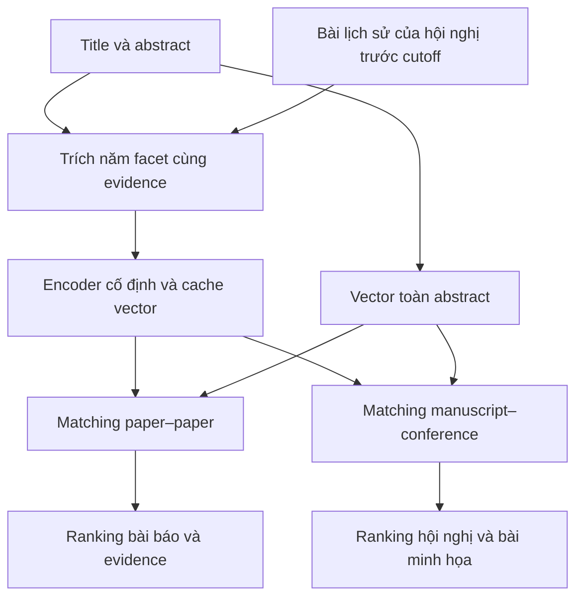

# Thu hẹp đề tài: năm facet từ abstract cho ranking bài báo và hội nghị

Ngày đối chiếu: 2026-10-23. Đây là nghiên cứu có chọn lọc và đề xuất phạm vi, chưa phải systematic literature review, thiết kế đã được duyệt, hay kết quả thực nghiệm. Không thay đổi README, protocol A–E, model, dữ liệu hoặc code hiện có.

## 1. Định hướng đề xuất

Một lõi nghiên cứu chung: trích xuất có evidence từ abstract thành `problem`, `task`, `method`, `dataset`, `contribution`; đánh giá biểu diễn này trong hai tác vụ: paper–paper ranking và manuscript–conference ranking.

Tên đề tài gợi ý: **Biểu diễn năm facet có dẫn chứng từ tóm tắt khoa học cho xếp hạng bài báo liên quan và hội nghị phù hợp**.

Tên tiếng Anh gợi ý: **Evidence-Grounded Five-Facet Representations for Scientific Paper and Conference Ranking**.

Với yêu cầu giảm scope, đề xuất tạm đưa profile dài hạn, suy ý định từ hành vi và temporal preference drift ra khỏi phần thực nghiệm chính. Tái sử dụng A và ý tưởng đối chứng của B; nhánh hội nghị có protocol riêng. Đây là đề xuất cho lần thu hẹp này, không tự động sửa quyết định cũ.

Theo README và DATA_CONTRACT hiện tại, corpus có 4.210 title/abstract từ CSFCube/SciFact; B–E dùng relevance/hành vi mô phỏng. Nhánh hội nghị chưa có bộ đánh giá riêng. Cần kiểm tra/bổ sung venue identity và năm công bố trước khi dùng corpus làm dữ liệu hội nghị; không suy rằng nguồn corpus hiện tại đã cung cấp đủ metadata hoặc đủ số bài mỗi venue.

## 2. Công trình sát nhất và điều chúng thực sự chứng minh

### SciER — EMNLP 2024

[Bài và PDF chính thức](https://aclanthology.org/2024.emnlp-main.726/).

**Đã kiểm chứng:** bộ dữ liệu 106 bài full text được gán nhãn thủ công, gồm entity về dataset/method/task và các quan hệ; có đánh giá ngoài phân phối và baseline LLM. Bài chỉ ra thông tin quan trọng không chỉ xuất hiện trong abstract.

**Giới hạn so với đề tài:** không phải benchmark trực tiếp cho cả năm facet của nhóm hay ranking hai đầu ra. Không thể lấy gold full text làm gold abstract mà không kiểm tra thông tin thực sự có trong abstract.

**Cơ hội đề xuất:** extraction bảo toàn nguồn và cho phép thiếu thông tin. Chất lượng phải đo trên phần có thể quan sát từ abstract, tránh ép LLM điền đủ dataset hoặc contribution.

### Specialized Document Embeddings for Aspect-based Similarity of Research Papers — JCDL 2022

[Bản tác giả](https://arxiv.org/abs/2203.14541).

**Đã kiểm chứng:** dùng Papers with Code để học embedding chuyên biệt cho task, method, dataset; nghiên cứu khuyến nghị bài báo. Phân tích phát hiện embedding toàn bài có thiên lệch khác nhau giữa dataset và method.

**Hệ quả:** ba trong năm facet đã có tiền lệ trực tiếp. Không thể trình bày task/method/dataset embeddings là ý tưởng mới.

**Cơ hội đề xuất:** kiểm tra giá trị tăng thêm của problem và contribution bằng ablation 3 facet so với 5 facet, thay vì mặc định nhiều facet tốt hơn.

### ASPIRE — NAACL 2022

[Bài và PDF chính thức](https://aclanthology.org/2022.naacl-main.331/).

**Đã kiểm chứng:** contextual sentence vectors, học từ co-citation contexts, matching một hoặc nhiều cặp bằng optimal transport. Có thể dùng câu được chọn để chỉ định khía cạnh.

**Giới hạn so với đề tài:** không cung cấp sẵn bộ trích concept–evidence đúng schema năm facet và protocol manuscript–conference của nhóm.

**Cần tránh:** ASPIRE không bị giới hạn kiến trúc ở đúng ba facet. Ba nhóm background/method/result là cấu trúc benchmark CSFCube, không phải toàn bộ khả năng biểu diễn.

### CoSAEmb — SDP 2024

[Bài và PDF chính thức](https://aclanthology.org/2024.sdp-1.27/).

**Đã kiểm chứng:** học biểu diễn từ full text và cấu trúc section bằng contrastive training; đánh giá trên SciRepEval và CSFCube.

**Cơ hội đề xuất:** chọn abstract-only là quyết định về chi phí và khả năng thu thập dữ liệu, không phải bằng chứng abstract chứa đủ thông tin. Báo cáo độ phủ từng facet và giới hạn biểu diễn.

### FaBle: Multi-Facet Blending for Faceted Query-by-Example Retrieval — ACL 2025

[Bài](https://aclanthology.org/2025.acl-long.1388/), [PDF, mục 3 và Limitations](https://aclanthology.org/2025.acl-long.1388.pdf).

**Đã kiểm chứng:** LLM tách, sinh và tổ hợp facet để tạo cặp huấn luyện contrastive; thử nghiệm paper retrieval và educational-item retrieval. Tác giả nói rõ facet summary hướng dẫn quá trình sinh, không bảo đảm là facet thực tế.

**Giới hạn tác giả nêu:** số query mỗi facet trong benchmark nhỏ làm hạn chế sức mạnh thống kê.

**Cơ hội đề xuất:** dùng cặp bài thật và gold extraction/relevance độc lập để đánh giá ảnh hưởng lỗi trích xuất. Không kết luận FaBle chỉ hoạt động trong khoa học hoặc hoàn toàn không có khả năng tổng quát hóa.

### FLeW — DASFAA 2025 theo ghi chú của tác giả

[Bản tác giả](https://arxiv.org/abs/2509.07531).

**Đã kiểm chứng:** khai thác citation intent, học biểu diễn background/method/result rồi tìm trọng số ghép cho tác vụ. Không cần fine-tune một module riêng cho mỗi tác vụ trong cơ chế ghép này.

**Hệ quả:** weighted-facet ranking và task-dependent weights đã có tiền lệ gần. Hàm tổng có trọng số là baseline/phương pháp hợp lý nhưng riêng nó không đủ tạo đóng góp mới.

### UniFAR — arXiv 2026, đối chiếu bản v2

[Bản tác giả](https://arxiv.org/abs/2602.23766), [toàn văn v2](https://arxiv.org/html/2602.23766v2).

**Đã kiểm chứng:** hỗ trợ doc–doc và question–doc trong không gian chung; learnable facet anchors, attention ở token/câu và huấn luyện kết hợp. Đánh giá CSFCube, DORIS-MAE và LitSearch. Dữ liệu facet có sentence labeling bằng LLM.

**Giới hạn so với đề tài:** các phép thử này chưa trực tiếp đánh giá manuscript–conference hoặc schema concept năm facet của nhóm.

**Hệ quả:** phát biểu “một biểu diễn dùng chung cho nhiều tác vụ” đã có tiền lệ; điều cần chứng minh là khả năng chuyển sang venue fit và độ bền khi thiếu/sai facet. Ghi nhận là preprint trong lần đối chiếu này.

### Can Instructed Retrieval Models Really Support Exploration? — CHIIR 2026

[Bản tác giả](https://arxiv.org/abs/2601.10936), [toàn văn tại CIIR](https://ciir-publications.cs.umass.edu/getpdf.php?id=1542), [chương trình hội nghị](https://chiir2026.github.io/detailed_schedule.html).

**Đã kiểm chứng:** ranking relevance tốt hơn không đồng nghĩa model nhạy với instruction chọn aspect. Các hệ thống có thể ít đổi kết quả hoặc phản ứng ngược trực giác với instruction.

**Cơ hội đề xuất:** nếu hỗ trợ chọn facet, thêm phép thử cùng abstract nhưng đổi facet; đánh giá ranking có thay đổi đúng với nhãn độc lập hay không. Chưa cần suy intent từ hành vi người dùng.

### Towards Explainable Scientific Venue Recommendations — 2021

[Bản tác giả](https://arxiv.org/abs/2109.11343).

**Đã kiểm chứng từ abstract:** topic model NMF được dùng để làm venue recommendation dễ giải thích hơn, với phương pháp học đơn giản nhưng kết quả cạnh tranh.

**Hệ quả:** “khuyến nghị hội nghị có giải thích” không mới tự thân. Hướng phân biệt của nhóm là giải thích vai trò problem/task/method bằng evidence đúng nguồn, thay vì chỉ hiển thị topic words; cần kiểm tra tính đúng và trung thành với scorer.

### GraphConfRec — JCDL 2021

[Bản tác giả](https://arxiv.org/abs/2106.12340), [toàn văn](https://arxiv.org/pdf/2106.12340).

**Đã kiểm chứng:** conference recommendation kết hợp title/abstract với citation và coauthorship bằng GNN; dùng SciGraph và có user study. Hạn chế tác giả nêu gồm nguồn publisher hẹp và conference chưa có trong train không được đề xuất.

**Cơ hội đề xuất:** manuscript-only phục vụ đầu vào chưa có citation graph. Đây là setting nhẹ hơn; không được lấy kết quả khác dữ liệu để tuyên bố hơn GraphConfRec. Đánh giá ngoài miền hoặc unseen venues là mở rộng, chưa cần biến thành mục tiêu bắt buộc.

### An explainable content-based approach for recommender systems: a case study in journal recommendation for paper submission — UMUAI 2024

[Toàn văn nhà xuất bản](https://link.springer.com/article/10.1007/s11257-024-09400-6).

**Đã kiểm chứng:** manuscript-based recommendation với journal topical subprofiles; giải thích dùng topic, bài liên quan và term/highlight; user study trong biomedical. Tác giả đã gắn giải thích với mô hình khuyến nghị.

**Cơ hội đề xuất:** phân biệt topic với vai trò problem/task/method, và đo explanation fidelity trên điểm thực sự dùng. Không chỉ để LLM viết một lời giải thích sau khi xếp hạng. Journal biomedical không phải conference CS nên cần protocol/dữ liệu phù hợp khi chuyển setting.

### Can Editorial Decisions Impair Journal Recommendations? — RecSys 2024

[Abstract và metadata từ tổ chức tác giả](https://research.uni-hannover.de/en/publications/can-editorial-decisions-impair-journal-recommendations-analysing-/).

**Đã kiểm chứng từ abstract:** abstract dài hơn và journal có nhiều bài hơn có thể được đẩy thứ hạng; điều chỉnh thuật toán giúp journal nhỏ trong hệ thống được nghiên cứu.

**Cơ hội đề xuất:** kiểm soát số bài mỗi venue và độ dài đầu vào, báo cáo macro theo venue và nhóm ít/nhiều bài. Không coi top-k mean tự động loại bỏ size bias; venue nhiều bài vẫn có nhiều cơ hội xuất hiện hàng xóm gần.

### Combining content information with collaborative filtering for publication venue recommendation — KAIS 2026

[Toàn văn nhà xuất bản](https://link.springer.com/article/10.1007/s10115-026-02749-7).

**Đã kiểm chứng:** xuất bản 15/4/2026; dùng nội dung để tăng cường author neighborhoods và venue ratings trong collaborative filtering, đánh giá PMSC-UGR/CORD-19. Đầu vào là lịch sử công bố của tác giả, khác manuscript-only. Tác giả ghi nhận redundancy khi đưa nội dung vào cả hai thành phần và đề nghị nghiên cứu biểu diễn giàu hơn.

**Cơ hội đề xuất:** manuscript-only giúp người chưa có publication history và giữ scope gọn. Role-specific facet matching là một giả thuyết biểu diễn đáng thử, chưa phải cách khắc phục redundancy đã được chứng minh.

## 3. Những gap nên chọn và những gap chưa thể khẳng định

Ba câu hỏi phù hợp nhất:

1. **RQ1 — Giá trị của schema:** năm facet có evidence có cải thiện ranking so với whole-abstract embedding và ba facet task/method/dataset, với cùng encoder và cùng pool?
2. **RQ2 — Sai số và thiếu thông tin:** lỗi extraction, lẫn problem/task và method/contribution, thiếu dataset, ảnh hưởng thế nào tới ranking? Cơ chế bỏ qua facet thiếu kết hợp điểm toàn abstract có giúp không?
3. **RQ3 — Tái sử dụng:** giữ nguyên extractor và encoder có hiệu quả cho cả paper–paper và manuscript–conference không? Có cần trọng số riêng cho hai tác vụ?

Đây là khoảng trống thực nghiệm có thể nghiên cứu trong dự án, không phải tuyên bố toàn ngành chưa từng có phương pháp như vậy. Muốn khẳng định novelty thuật toán cần rà soát sâu thêm uncertainty-aware retrieval và scholarly venue recommendation.

Không dùng các phát biểu: “đầu tiên tách năm facet”, “đầu tiên dùng chung biểu diễn”, “đầu tiên giải thích venue recommendation”, hoặc “các bài trước đều không xử lý facet thiếu”. Không thấy phép thử trong một số bài không chứng minh không ai đã làm.

## 4. Pipeline tối thiểu đề xuất

### Trích xuất và biểu diễn

- Mỗi concept lưu facet, evidence quote và vị trí nguồn nếu có. Evidence tồn tại trong abstract chưa đủ chứng minh gán facet đúng; cần human review.
- Một câu có thể hỗ trợ nhiều facet khi nội dung cho phép. Không ép chia abstract thành đúng năm đoạn hay mỗi câu đúng một nhãn.
- `dataset=[]` nghĩa không thấy thông tin đủ rõ trong abstract, không phải nghiên cứu không dùng dữ liệu. Phân biệt với lỗi extraction/chưa xử lý record.
- `contribution` là đóng góp tác giả nêu, không phải điểm độ mới hay chất lượng đã được thẩm định.
- Bắt đầu bằng concept + evidence làm đầu vào một encoder cố định; ablate concept-only. Không bắt buộc train encoder mới.

### Ranking bài báo

Một phương án tối thiểu là kết hợp điểm whole-abstract với tổng similarity từng facet có trọng số. Mask facet không có evidence, chuẩn hóa lại trên các facet có thể so; nếu không còn facet dùng được thì fallback whole-abstract. Báo cáo coverage để tránh một facet đơn lẻ có điểm cao làm hệ thống tự tin quá mức.

Trọng số đặt/tune bằng train/dev, không dựa trên test. Có thể bắt đầu bằng 5 trọng số không âm, thay vì một neural reranker mới. Nếu muốn thêm confidence, phải kiểm chứng/hiệu chỉnh trên dev; không dùng xác suất LLM tự tuyên bố như confidence đã đáng tin.

### Ranking hội nghị

Giữ nguyên extractor và encoder. Xây hồ sơ conference bằng facet của các bài đã xuất bản và đã có sẵn trước thời điểm khuyến nghị; tách conference series, edition/year và workshop. Bỏ chính query, bản trùng và phiên bản gần trùng khỏi hồ sơ.

So ba cách: centroid toàn abstract, centroid theo facet, và tùy chọn trung bình top-k điểm của các bài lịch sử phù hợp theo facet. Cách top-k là thử nghiệm bổ sung để kiểm tra venue đa chủ đề; không bắt buộc đưa vào vòng đầu. Chuẩn hóa/cân bằng số bài mỗi venue, vì venue lớn có nhiều cơ hội đạt max similarity cao.

Học/tune trọng số riêng cho venue ranking. Giả thuyết là problem/task/method có thể phản ánh scope rõ hơn dataset identity; phải kiểm tra bằng ablation, không mặc định loại dataset hoặc contribution.

CFP/topics có thể bổ sung khi nguồn và thời điểm rõ ràng, nhưng không ép CFP thành đủ năm facet: CFP không phải một bài nghiên cứu và thường không có dataset/contribution cụ thể.

Đầu ra là mức phù hợp nội dung. Acceptance probability, deadline, phí, địa điểm và chất lượng venue là các mục tiêu khác, chưa thuộc scope đề xuất.

## 5. Đánh giá vừa sức và có khả năng phản bác giả thuyết

| Phần | Thiết kế tối thiểu đề xuất | Điều đo |
|---|---|---|
| Extraction | Human-review một tập held-out, có subset hai người chấm độc lập và xử lý bất đồng | P/R/F1 theo facet; evidence support; lỗi lẫn vai trò; phát hiện thiếu thông tin; chi phí |
| Paper ranking | Cùng candidate pool và nhãn graded relevance độc lập cho mọi phương pháp | nDCG@10, Recall@K khi nhãn cho phép; theo facet và theo mức thiếu thông tin |
| Conference ranking | Train/dev/test theo thời gian; chỉ dùng metadata/papers có sẵn trước cutoff | MRR, Recall@3/5 đối với venue đã công bố; thêm nDCG@5 trên subset có nhiều venue được chấm phù hợp |
| Robustness | So predicted facets với human-corrected facets trên cùng subset; thêm mask/noise có kiểm soát | Mức suy giảm ranking khi extraction sai/thiếu và khả năng fallback |
| Transfer | Freeze extractor/encoder; so shared weights với weights riêng hai tác vụ | Hiệu quả tái sử dụng biểu diễn và lợi ích specialization nhẹ |

Đề xuất pilot về khối lượng, chưa phải cỡ mẫu đủ sức mạnh thống kê: 100–200 abstracts review extraction; 20–30 paper queries với khoảng 20 candidates/query từ union các baseline; venue catalog 10–20 hội nghị có chủ đề giao nhau nếu thu thập đủ metadata. Ưu tiên một subset nhỏ được chấm kỹ hơn là nhiều nhãn do cùng pipeline tự sinh.

Với hội nghị, venue đã đăng là **observed positive**, không chứng minh mọi venue khác đều không phù hợp. Để đánh giá venue fit, chọn thêm một subset, ví dụ 30 manuscript queries × 5–10 venues, cho người chấm graded suitability dựa trên nội dung và scope; không lộ model/score. Quy mô này chỉ là pilot và phải điều chỉnh theo nguồn lực.

Không chấm relevance bằng chính công thức overlap facet mà scorer đang tối ưu. Nhãn AI hỗ trợ được nhưng phải ghi rõ, có review độc lập; human gold extraction không tự trở thành human relevance gold.

Nếu chạy CSFCube: giữ nguyên nhãn background/method/result, IDs, pools và evaluator gốc. Không tự đổi result thành contribution hoặc background thành problem/task. Phân biệt nDCG theo phần trăm pool (`nDCG%20`) với `nDCG@20`. Benchmark gốc là kiểm tra bổ sung; không bắt buộc thay quyết định cũ không dùng CSFCube cho đánh giá năm facet.

### Bộ đối chứng ưu tiên

1. BM25 hoặc TF-IDF trên title/abstract.
2. Whole-abstract semantic embedding.
3. Equal-weight facet, cùng encoder.
4. Weighted facet, cùng encoder.
5. Weighted facet + missing-facet handling + whole-abstract fallback.
6. Một scientific comparator như SPECTER2/ASPIRE nếu có thể tích hợp đúng protocol.

Venue thêm popularity/most-common-venue và whole-abstract centroid. Không so trực tiếp điểm số từ các paper có split/pool/metric khác nhau.

Các ablation ưu tiên: ba so với năm facet; bỏ từng facet; concept-only so concept+evidence; shared weights so task-specific; có/không mask và fallback; predicted so human-corrected facets. Chạy theo thứ tự để tránh tích chập mọi biến thể thành một ma trận quá lớn.

## 6. Đóng góp có thể bảo vệ

Một phát biểu phù hợp trước khi có kết quả:

> Chúng tôi nghiên cứu biểu diễn năm facet có dẫn chứng từ abstract, đánh giá ảnh hưởng của sai số và thiếu thông tin tới ranking, và kiểm tra khả năng tái sử dụng biểu diễn cho khuyến nghị bài báo liên quan và hội nghị phù hợp nội dung.

Nếu thực nghiệm xác nhận, có thể đóng góp: guideline và tập review chất lượng; phân tích downstream của extraction; một cơ chế ranking nhẹ có đối chứng; protocol venue-fit theo thời gian và đánh giá đa nhãn phù hợp.

Tổ hợp hệ thống là đóng góp ứng dụng hợp lý cho đồ án. Để hướng tới publication, cần xác định hiệu quả nào vượt đối chứng mạnh và phân tích đủ sâu. Năm facet cộng trọng số rồi xuất hai danh sách chưa tự tạo novelty phương pháp.

## 7. Ghi chú phiên bản nguồn và giới hạn

- `arXiv:2507.10057` từng mang tên PRISM; trang hiện tại v4 sửa ngày 18/10/2026 mang tên **Chain of Retrieval: Multi-Aspect Iterative Search Expansion and Post-Order Search Aggregation for Full Paper Retrieval**. [Nguồn hiện tại](https://arxiv.org/abs/2507.10057). Bản này dùng multi-aspect full-paper retrieval và mở rộng tìm kiếm lặp. Không trích mô tả PRISM cũ như thể là tên và phương pháp mới nhất.
- `arXiv:2501.01203` từng được tìm thấy dưới tên HetGCoT-Rec journal recommendation; trang hiện tại v3 là **HetGCoT ... Academic Question Answering**, liên kết Findings EMNLP 2025. [Nguồn hiện tại](https://arxiv.org/abs/2501.01203). Khi dùng nghiên cứu venue ở v1 phải ghim đúng phiên bản và mô tả sự thay đổi; không coi v1 là bài venue hiện hành.
- SciFACE được đối chiếu từ [abstract arXiv](https://arxiv.org/abs/2604.16329): hai cross-encoder Background/Method và cặp bài thật có nhãn LLM đối chiếu human. Có thể đọc bổ sung cho reranking; lần này không dùng con số của abstract để khẳng định vượt các bài khác, vì cần kiểm tra lại metric/protocol.
- Không tái lập model hoặc kiểm chứng mọi số liệu. Một số nguồn chỉ kiểm chứng abstract; từng mục đã ghi rõ. UniFAR/SciFACE không được mặc định coi là đã phản biện chỉ vì có bản arXiv. Nguồn ScienceDirect của HASVRec/mCTRL bị 403 ở lần tra cứu này nên không dùng làm trụ chính cho kết luận mới.

