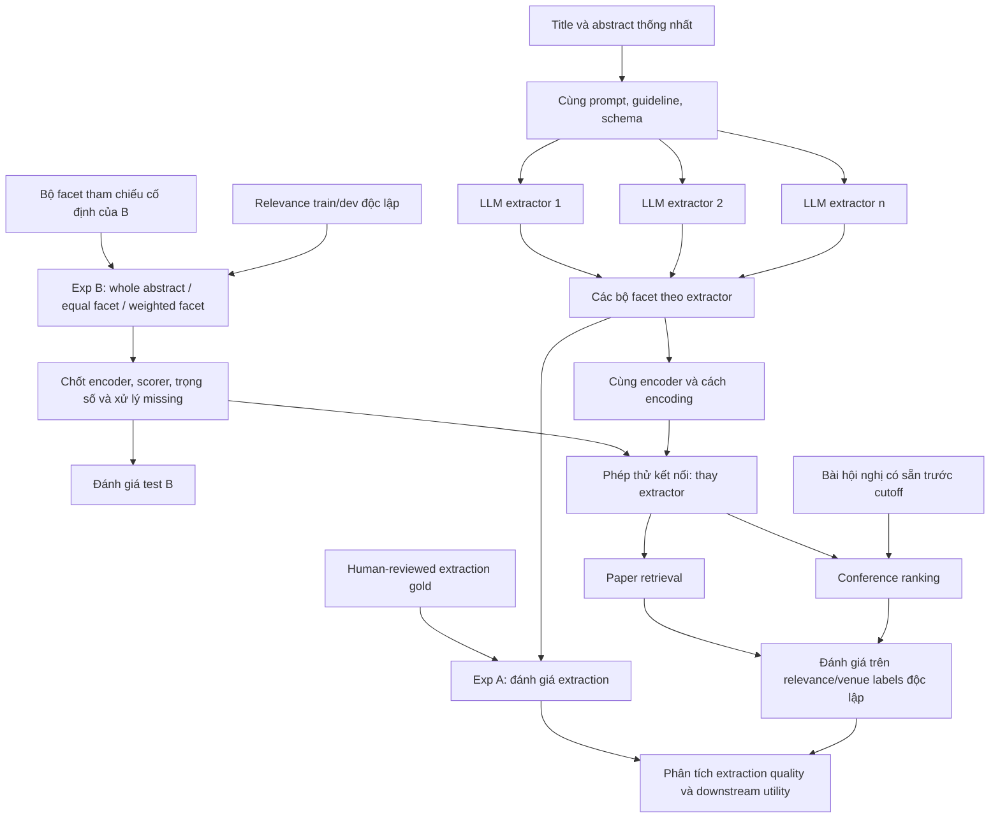

# Cấu trúc paper: LLM facet extraction và downstream recommendation

Ngày ghi nhận: 23/10/2026.

Tài liệu tổng hợp phương án đã thống nhất trong trao đổi: giữ thí nghiệm A về extraction, giữ B về ranking theo facet và dùng **một bộ trọng số chung giữa các extractor**. Những chi tiết chưa lựa chọn được ghi là đề xuất hoặc cần chốt. Tài liệu không thay đổi code, dataset, DATA_CONTRACT hoặc protocol A–E hiện có.

## 1. Trọng tâm và phạm vi

Nghiên cứu ảnh hưởng của LLM-based scientific facet extraction tới hai tác vụ:

1. **Paper retrieval:** tìm bài liên quan từ một manuscript hoặc bài mốc.
2. **Manuscript-based conference recommendation:** xếp hạng hội nghị phù hợp với nội dung manuscript.

Đầu vào nghiên cứu là **title và abstract**. Upload PDF là cách tiếp nhận tài liệu trong ứng dụng; xử lý full text chưa thuộc phương án chính. Không cần triển khai giao diện upload để thực hiện các thí nghiệm offline.

Năm facet gồm `problem`, `task`, `method`, `dataset`, `contribution`. Một bộ extractor tạo các concept cùng evidence từ title/abstract; thông tin không được nêu đủ rõ được phép để thiếu.

Câu hỏi trung tâm:

> Với cùng quy trình downstream, các LLM extractor tạo ra biểu diễn facet khác nhau ảnh hưởng thế nào đến chất lượng tìm bài và khuyến nghị hội nghị? Chất lượng extraction có phản ánh chất lượng downstream không?

Paper theo hướng **nghiên cứu thực nghiệm có kiểm soát**. Không đặt yêu cầu phát minh đồng thời extractor, embedding model, paper ranker và conference ranker mới.

Tên tiếng Anh tạm đề xuất:

**From Facet Extraction to Scientific Recommendation: Evaluating LLM Extractors for Paper Retrieval and Conference Ranking.**

## 2. Các quyết định đã thống nhất

| Nội dung | Phương án |
|---|---|
| Extraction | Cùng nội dung prompt, guideline và schema chạy trên các LLM khác nhau. |
| Schema | Giữ năm facet problem, task, method, dataset, contribution. |
| Exp A | Đánh giá chất lượng extraction riêng. |
| Exp B | Giữ phép so whole-abstract, equal-facet, weighted-facet ranking. |
| Trọng số | Một bộ trọng số chung giữa các extractor trong phép so chính. |
| Tính độc lập | B chạy với một bộ facet đầu vào cố định, không cần đợi điểm hoặc kết luận của A. |
| Phép thử kết nối | Đưa đầu ra từng extractor vào ranker đã cố định từ B, không tune lại theo extractor. |
| Conference | Là downstream thứ hai của biểu diễn facet, đầu vào là manuscript. |
| Kế thừa | Dựa trên phương pháp có sẵn, tự xây phần tích hợp và protocol đánh giá cần thiết. |

**Ý nghĩa của “B độc lập”:** B vẫn cần dữ liệu facet đầu vào. B không cần chạy tất cả LLM, đợi A chọn model tốt nhất hoặc đọc nhãn/điểm test của A mới tiến hành được.

**Ý nghĩa của “trọng số chung”:** các extractor dùng cùng bộ trọng số trong một phép so downstream. Điều này chưa tự động yêu cầu paper ranking và conference ranking phải dùng cùng trọng số; quyết định giữa hai tác vụ được tách ở mục 7.

## 3. Phát biểu bài toán và câu hỏi nghiên cứu

### 3.1. Vấn đề cần giải quyết

Trong hệ thống dùng LLM để trích facet rồi khuyến nghị, người triển khai phải chọn extractor và cách sử dụng đầu ra của nó. Điểm extraction cho biết mức khớp với annotation tham chiếu, nhưng chưa trực tiếp cho biết biểu diễn đó giúp xếp hạng bài hoặc hội nghị tốt đến đâu trong hệ thống đang xét.

Bài toán của paper là **đánh giá lựa chọn extractor dưới một quy trình ranking được kiểm soát**, đồng thời kiểm tra giá trị của biểu diễn theo facet và trọng số. Quan hệ giữa extraction quality và downstream utility là điều cần thực nghiệm xác định; không giả định sẵn rằng hai đại lượng tương quan yếu hoặc một model mạnh hơn sẽ luôn tốt hơn.

Phát biểu ngắn có thể dùng khi giới thiệu đề tài:

> Cho cùng tập title/abstract và schema năm facet, nghiên cứu so sánh các LLM extractor về độ chính xác trích xuất và mức hữu ích cho paper retrieval, conference recommendation; kiểm tra các khác biệt đó bằng encoder, cơ chế ranking và bộ trọng số chung đã được cố định độc lập.

### 3.2. Đầu vào, đầu ra và đối tượng đánh giá

| Bài toán | Đầu vào | Đầu ra cần đánh giá |
|---|---|---|
| Facet extraction | Title/abstract `x`, prompt và guideline chung, extractor `E_i` | Năm nhóm concept `F_i(x)` cùng evidence và trạng thái thiếu/thất bại. |
| Paper ranking | Bài mốc `q`, tập ứng viên `D`, bộ facet tương ứng, encoder và scorer đã khóa | Danh sách bài `D` theo mức liên quan, đối chiếu relevance labels độc lập. |
| Conference ranking | Manuscript `q`, catalog hội nghị `V`, hồ sơ lịch sử trước cutoff, cấu hình ranking đã khóa | Danh sách hội nghị `V` theo mức phù hợp nội dung, đối chiếu venue labels theo protocol. |
| Lựa chọn extractor | Kết quả extraction, downstream và chi phí của các `E_i` trên cùng điều kiện | Bằng chứng về trade-off và các trường hợp nên/chưa nên chọn một extractor theo tiêu chí đã định nghĩa. |

Không tối ưu một điểm tổng hợp tùy ý giữa F1, nDCG và chi phí. Báo riêng từng khía cạnh để thấy trường hợp chất lượng và chi phí đánh đổi nhau.

### 3.3. Hai phép so phải phân biệt

**Phép so thiết kế ranker trong B:** cố định `F_ref`, thay cách biểu diễn/tổng hợp điểm giữa whole abstract, equal facet và weighted facet. Phép so này trả lời lợi ích của facet và trọng số trên bộ đầu vào đã xác định.

**Phép so lựa chọn extractor:** cố định downstream từ B, thay `F_i` do từng LLM sinh. Phép so này trả lời ảnh hưởng của lựa chọn extractor trong pipeline đã khóa. Nó không chứng minh model nào tốt nhất với mọi prompt, encoder hoặc miền dữ liệu.

### 3.4. Câu hỏi nghiên cứu cụ thể

| Mã | Câu hỏi | Thí nghiệm trả lời |
|---|---|---|
| RQ1 | Các LLM trích năm facet đúng, đủ và có evidence phù hợp đến đâu? | A |
| RQ2 | Trên đầu vào facet cố định, chia facet và gán trọng số có giúp paper ranking hơn whole abstract không? | B |
| RQ3 | Khi downstream cố định, thay extractor làm paper retrieval và conference ranking thay đổi thế nào? | Phép thử kết nối và nhánh conference |
| RQ4 | Điểm extraction, kiểu lỗi và chi phí có giải thích được khác biệt downstream không? | Phân tích kết hợp |

RQ2 giúp B có giá trị nghiên cứu riêng. RQ3–RQ4 kết nối A với B và tạo câu chuyện chung cho paper.

Các phép kiểm tra tương ứng:

- **RQ1:** cùng gold và quy tắc matching; so P/R/F1 từng facet, evidence support và tỷ lệ thất bại giữa các extractor.
- **RQ2:** trên `F_ref`, so whole abstract → equal facet → weighted facet; xác định phần tăng/giảm do chia facet và do trọng số.
- **RQ3:** dùng nguyên ranker và shared weights, so downstream giữa các extractor; kiểm tra thứ hạng extractor có giữ nguyên qua hai tác vụ không.
- **RQ4:** đối chiếu thứ hạng extraction/downstream, phân tích lỗi trên subset giao nhau và chi phí. Các quan hệ quan sát được cần phân biệt với kết luận nhân quả; nếu sửa lỗi để đo tác động thì mô tả thành một intervention riêng.

### 3.5. Điều paper không đặt mục tiêu chứng minh

Không tìm “LLM tốt nhất nói chung”, không xây “recommender tối ưu nhất” cho mọi tình huống, không dự đoán acceptance probability và không yêu cầu một thuật toán ranking mới. Mục tiêu là có bằng chứng tái lập được về extractor và weighted-facet ranking trong miền, dữ liệu và protocol đã chọn.

## 4. Flow nghiên cứu

Nhãn test chỉ đi vào evaluator, không đi vào extractor, chọn trọng số hoặc xây hồ sơ hội nghị. Các bộ facet theo extractor phải giữ cùng paper IDs và nguồn văn bản để đối chiếu được.

## 5. Exp A: so sánh LLM extraction

### 5.1. Mục tiêu và đầu vào

So các LLM trên cùng title/abstract, cùng định nghĩa năm facet và cùng yêu cầu evidence. Không tự chọn output của model dựa trên nhãn test.

Giữ nội dung chỉ dẫn tương đương nhưng dùng chat template đúng của từng model. Ghi model/checkpoint, decoding, token budget, truncation, seed và phiên bản prompt. Cùng prompt không bảo đảm mọi model được khai thác tốt nhất; kết luận cần giới hạn theo protocol đã thử.

### 5.2. Đầu ra và xử lý lỗi

- Concept phải đi kèm evidence hỗ trợ đúng vai trò.
- Facet không có đủ evidence được ghi `[]`; tách trạng thái này với record chưa xử lý hoặc inference thất bại.
- Không suy dataset từ kiến thức nền hoặc biến contribution thành điểm novelty đã được thẩm định.
- Quy tắc parse, retry, chuẩn hóa tên và chọn output phải chung giữa các model, có version.
- Báo cả tỷ lệ hoàn tất, lỗi định dạng và chất lượng ngữ nghĩa. Không âm thầm loại các ca model thất bại để tăng điểm.

### 5.3. Đánh giá

Gold extraction là tập người review độc lập; AI reference không được gọi là human gold. Có subset được hai người chấm, xử lý bất đồng và khóa guideline trước test.

Đề xuất báo P/R/F1 theo facet, macro/micro, evidence support, tỷ lệ thêm thông tin không có nguồn, phát hiện missing, latency và token/cost khi đo được. Quy tắc matching concept/alias cần chốt trên dev; không để similarity của evidence thay thế việc kiểm tra đúng vai trò.

Không bắt buộc fine-tune mới. Nếu so base với fine-tuned model, coi đó là các extractor configurations và công bố nguồn huấn luyện, split và nguy cơ trùng dữ liệu.

## 6. Exp B: ranking theo facet với trọng số chung

### 6.1. Bộ đầu vào độc lập của B

Chọn trước một bộ facet tham chiếu `F_ref`, công bố nguồn, version và phạm vi bao phủ. Bộ này có thể là output đóng băng của một extractor hoặc bộ annotation đã review; nguồn cụ thể **chưa chốt**.

Không chọn `F_ref` vì model đạt điểm test A cao nhất. Không tối ưu trọng số bằng trung bình điểm mọi extractor, vì cách đó khiến việc chuẩn bị B phải chờ đầu ra của A.

`F_ref` là **đầu vào tham chiếu**, không mặc định là gold. Nếu có nhãn gold extraction hoặc reference được review thì mô tả riêng.

### 6.2. Ba phương pháp chính

| Phương pháp | Biểu diễn và scorer | Vai trò |
|---|---|---|
| Whole abstract | Encoder trên title/abstract, similarity toàn bài | Baseline không extraction |
| Equal facet | Encoder từng facet, tổng hợp trọng số bằng nhau trên facet dùng được | Đo lợi ích chia facet |
| Weighted facet | Cùng encoder và facet text, tổng hợp bằng trọng số tìm trên train/dev B | Đo lợi ích gán trọng số |

Để so equal/weighted công bằng, giữ cách encoding, candidate pool và missing handling giống nhau. Whole-abstract là baseline chung, không cần nhân bản kết quả theo từng extractor.

### 6.3. Hàm điểm tham khảo

Với tập facet `F`, đặt `s_f(q,d)` là similarity và `m_f(q,d)` là mask cho biết facet hai bên đủ điều kiện so sánh. Một cách tổng hợp đề xuất:

\[
S_w(q,d)=\frac{\sum_{f\in F}m_f(q,d)w_f s_f(q,d)}{\sum_{f\in F}m_f(q,d)w_f},\qquad w_f\geq0,\quad\sum_f w_f=1.
\]

Equal-facet dùng các trọng số bằng nhau. Nếu mẫu số bằng 0, cần fallback whole abstract hoặc một chính sách abstention thống nhất. Chính sách cụ thể là chi tiết cần chốt trước test. Mẫu ít facet có thể bị đánh giá quá cao sau chuẩn hóa, nên báo coverage và kết quả theo mức thiếu thông tin.

Công thức trên là baseline minh bạch để triển khai, chưa phải tuyên bố thuật toán mới. Không so sánh hoặc cộng các điểm có thang đo khác nhau mà chưa xác định cách chuẩn hóa.

### 6.4. Chọn và khóa trọng số

1. Cố định split và một metric chính, đề xuất nDCG@10 nếu phù hợp tập relevance.
2. Chọn trọng số trên train/dev B, cùng `F_ref` và ngân sách tìm kiếm đã quy định.
3. Khóa `w_B`, encoder, facet text, normalizer, scorer và missing policy.
4. Đánh giá test B một lần theo protocol đã chốt.
5. Dùng nguyên cấu hình đóng băng cho phép thử kết nối.

Trọng số là tĩnh cho tất cả query trong cấu hình chính; chưa học theo từng query, candidate, người dùng hoặc extractor.

### 6.5. Relevance và phạm vi kết luận

Relevance judgments phải độc lập với công thức overlap/similarity facet được dùng trong scorer. Gold extraction không tự tạo gold relevance. Dữ liệu mock sinh theo luật facet của dự án chỉ hỗ trợ kiểm tra cơ chế, không đủ xác nhận hiệu quả semantic ranking thực tế.

Giữ cùng judged pools để cô lập scorer. Nếu chưa đánh giá retrieval toàn corpus thì gọi đúng là ranking trong pool; không suy Recall toàn corpus từ một tập nhãn không đầy đủ. Chọn cutoff và metric theo protocol dữ liệu; `nDCG%20` của benchmark gốc không đồng nghĩa `nDCG@20`.

## 7. Phép thử kết nối và conference recommendation

### 7.1. Kết nối A–B: thay dữ liệu facet, giữ downstream

Với mỗi extractor `E_i`, trích lại cả query và candidate corpus thành `F_i`, rồi đưa vào cấu hình B đã khóa. Không chỉ thay query trong khi candidate vẫn dùng extractor khác, trừ khi làm phép thử riêng có ghi tên.

| Biểu diễn | Paper retrieval | Conference ranking |
|---|---|---|
| Whole abstract | Baseline dùng chung | Baseline hồ sơ whole-abstract |
| `F_i` + equal weights | So cho từng extractor | So cho từng extractor |
| `F_i` + shared weights | Dùng nguyên `w_B` cho mọi extractor | Trọng số chung trong tác vụ conference, theo lựa chọn mục 7.3 |

Vì các query/pool/nhãn giống nhau, có thể so paired query-level differences. Báo độ bất định của chênh lệch bằng phương pháp phù hợp như paired bootstrap theo query. Nếu một query có nhiều facet cases, cân nhắc resample theo nhóm query paper để không giả định chúng độc lập.

### 7.2. Xây hồ sơ hội nghị

Đầu vào là title/abstract của manuscript; output là hội nghị phù hợp nội dung, không phải acceptance probability.

Với extractor `E_i`, hồ sơ hội nghị được xây từ facet do chính `E_i` trích trên các bài lịch sử. Giữ catalog, lịch sử, số lượng bài, thời điểm và cách tổng hợp giống nhau giữa các extractor.

Phương án khởi đầu đề xuất: centroid theo facet, với baseline centroid toàn abstract. Top-k paper aggregation có thể bổ sung sau. Không bắt buộc GNN, author history hoặc CFP crawler.

Chỉ sử dụng bài và metadata có sẵn trước cutoff. Loại query và bản trùng/gần trùng khỏi hồ sơ. Tách conference series, edition, workshop và journal. Corpus hiện có cần được kiểm tra venue identity/year và coverage; không mặc định metadata đã đủ.

Venue lớn có nhiều bài có thể được lợi; giữ ngân sách lịch sử tương đương hoặc kiểm tra sensitivity theo venue size, báo macro/nhóm venue nếu dữ liệu cho phép.

### 7.3. Trọng số giữa hai tác vụ: chưa chốt

Quyết định đã chốt là **chung giữa các extractor**. Có hai cách triển khai conference:

- **Đề xuất vòng đầu:** dùng nguyên `w_B` để kiểm tra transfer từ paper ranking sang conference ranking; không cần học bộ trọng số mới.
- **Mở rộng tùy nguồn lực:** chọn một `w_V` trên conference dev và hồ sơ tham chiếu cố định, sau đó dùng chung `w_V` cho tất cả extractor. Đây là cấu hình theo tác vụ, vẫn không tune riêng từng extractor.

Không trình bày `w_V` là quyết định đã được người dùng chốt. Nếu chạy cả hai, báo thành hai điều kiện: transferred weights và venue-tuned shared weights.

### 7.4. Nhãn và metric conference

Venue thực tế đã công bố là observed positive, không chứng minh các venue khác đều không phù hợp. Temporal venue prediction và đánh giá semantic venue fit cần được phân biệt.

Đề xuất MRR/Recall@3 hoặc @5 cho observed venue và một subset nhiều venue được người chấm graded suitability để đánh giá fit. Candidate catalog, canonical venue IDs và cách xử lý unseen venue phải được công bố. Nếu không có nhãn đa venue thì giới hạn kết luận ở bài toán đã đo.

## 8. Phân tích kết hợp: nội dung quan trọng của paper

### 8.1. Chất lượng extraction và downstream

- So thứ hạng extractor theo extraction F1, paper ranking và conference ranking.
- Kiểm tra thứ hạng có đổi giữa hai tác vụ không.
- Với ít model, không diễn giải tương quan từ vài điểm trung bình thành kết luận tổng quát. Dùng thêm phân tích query/paper-level và các ca lỗi được review.
- Gold extraction subset và relevance queries cần được liên kết hoặc có subset giao nhau thì mới phân tích trực tiếp lỗi extraction với tác động từng query. Nếu hai tập không trùng, chỉ so được tổng hợp và phải ghi giới hạn.

### 8.2. Phân loại lỗi đề xuất

| Loại lỗi | Ví dụ cần kiểm tra |
|---|---|
| Sai vai trò | Method của baseline bị coi là phương pháp chính của bài. |
| Lẫn facet | Problem/task hoặc method/contribution bị gán không đúng. |
| Không có nguồn | LLM bổ sung dataset hoặc claim không xuất hiện trong abstract. |
| Bỏ sót | Thiếu facet có evidence hoặc chỉ giữ một phần concept quan trọng. |
| Chuẩn hóa | Cùng khái niệm nhưng tên khác; alias sai gộp hai khái niệm khác nhau. |
| Dư thừa | Cùng thông tin lặp ở nhiều facet, có thể bị tính nhiều lần trong scorer. |

Đây là taxonomy phục vụ phân tích, chưa phải khẳng định các lỗi đã xảy ra hoặc gây hại theo thứ tự nào. Có thể sửa một subset lỗi rồi chạy lại ranking với cùng cấu hình để kiểm tra tác động, nếu đủ nhãn.

### 8.3. Chi phí và giới hạn

Báo latency, throughput, tỷ lệ output hợp lệ và token/cost nếu đo được. Tách chi phí extraction offline với query-time ranking. Không suy chi phí model mở từ giá API không tương đương.

Trọng số `w_B` học trên `F_ref` có thể hợp với nguồn đó hơn extractor khác. Công bố nguồn và xem chuyển giao sang extractor khác là một phần thực nghiệm; không khẳng định ranker hoàn toàn trung lập với nguồn facet. Nếu cần, sensitivity với nguồn tham chiếu thứ hai là mở rộng, không bắt buộc cho vòng đầu.

## 9. Dàn ý bản thảo paper

| Mục | Nội dung chính |
|---|---|
| Abstract | Câu hỏi, thiết kế A/B độc lập và phép thử kết nối, dữ liệu, kết quả thật, giới hạn. Chỉ viết kết luận sau thí nghiệm. |
| 1. Introduction | Động cơ facet representation; vấn đề chọn extractor theo F1 có phản ánh downstream hay không; RQs và đóng góp. |
| 2. Related Work | Scientific IE, faceted retrieval/weighted ranking, extractor–downstream studies, manuscript–venue recommendation. |
| 3. Task and Data | Định nghĩa năm facet, extraction gold, relevance labels, venue catalog, split và cutoff. |
| 4. Experimental Framework | Protocol chung; A; ranker B và chọn shared weights; phép thử kết nối; conference aggregation. |
| 5. Results | Extraction A; baseline và weighted ranking B; tác động extractor; conference results. |
| 6. Analysis | F1–downstream relationship, lỗi theo facet, chi phí, missingness và reference-source bias. |
| 7. Limitations | Nhãn, cỡ tập query, phạm vi model/prompt/domain, venue positives, coverage và temporal metadata. |
| 8. Conclusion | Chỉ kết luận trong phạm vi dữ liệu, model, prompt và ranker đã thử. |
| Appendix | Prompt/schema, guideline, model revisions, tuning grid, hyperparameters, examples và protocol tái lập. |

Các bảng kết quả nên chuẩn bị: model/config inventory; extraction scores; B whole/equal/weighted; downstream theo extractor; conference scores; error/cost analysis. Bảng phải thể hiện rõ nguồn facet và bộ trọng số, tránh gộp các điều kiện khác nhau vào một điểm chung.

## 10. Contribution dự kiến và bằng chứng cần có

### 10.1. Ba contribution trung tâm

Các mục sau là **đóng góp nghiên cứu dự kiến**, chưa phải kết quả đã đạt. Chúng mô tả nội dung cần hoàn thành để có thể viết vào paper sau thực nghiệm.

| Mã | Contribution dự kiến | Nội dung cụ thể | Bằng chứng cần có |
|---|---|---|---|
| C1 | Protocol đánh giá LLM facet extraction và giá trị downstream | Thống nhất schema, prompt, evidence policy và model conditions; A/B có mục tiêu riêng; downstream khóa độc lập trước phép so extractor. | Guideline, split, model revisions, prompt/schema, `F_ref`, trọng số và evaluator có thể tái lập; nhãn đánh giá độc lập. |
| C2 | Đánh giá có kiểm soát giá trị của facet representation và shared-weight ranking | Giữ B để đo whole-abstract/equal-facet/weighted-facet; dùng chung ranker và trọng số khi kiểm tra các extractor ở paper retrieval và conference ranking. | Bảng baseline/ablation, paired comparisons và độ bất định; tách rõ điểm B trên `F_ref` với điểm phép thử kết nối trên `F_i`. |
| C3 | Phân tích quan hệ giữa extraction quality và downstream utility | Xác định khi nào điểm extraction phản ánh hoặc không phản ánh ranking, khác biệt theo facet/tác vụ và loại lỗi; bổ sung trade-off chi phí. | Phân tích query/paper-level trên subset liên kết, error taxonomy có review, trường hợp thắng/thua và kiểm tra sửa lỗi nếu thực hiện. |

Trong đó **C3 là trọng tâm phát hiện thực nghiệm**; C1 tạo nền tảng kiểm chứng, C2 cung cấp các phép so để giải thích kết quả. Chỉ liệt kê nhiều model hoặc nhiều metrics chưa đủ thay thế chiều sâu phân tích này.

Khả năng chuyển kết luận từ paper retrieval sang conference recommendation nằm trong C2–C3; không cần tách thành một tuyên bố novelty chỉ vì có thêm đầu ra hội nghị.

### 10.2. Đóng góp dữ liệu và hệ thống ở mức hỗ trợ

Nếu tập annotation/relevance mới được xây và kiểm tra đủ chất lượng, có thể bổ sung đóng góp tài nguyên gồm guideline, human-reviewed subset và metadata/protocol. Chỉ tuyên bố release dữ liệu/code khi thực sự có artifact và quyền chia sẻ phù hợp; corpus hoặc nhãn AI có sẵn không tự trở thành benchmark human gold mới.

Pipeline tái lập được là sản phẩm hỗ trợ nghiên cứu. Một ứng dụng upload và hiển thị hai danh sách có giá trị triển khai, nhưng chưa thay thế contribution thực nghiệm và không phải yêu cầu bắt buộc của paper này.

### 10.3. Đoạn contribution mẫu cho proposal

> Nghiên cứu dự kiến đóng góp ba nội dung: (1) một protocol thống nhất để đánh giá các LLM trích xuất năm facet khoa học có dẫn chứng; (2) một đánh giá có kiểm soát về lợi ích của facet representation và trọng số, cùng ảnh hưởng của lựa chọn extractor đối với paper retrieval và manuscript-based conference recommendation dưới downstream cố định; và (3) một phân tích về quan hệ giữa độ chính xác extraction, các loại lỗi facet, hiệu quả downstream và chi phí, nhằm hỗ trợ lựa chọn extractor phù hợp cho hệ thống khuyến nghị khoa học.

Đoạn trên dùng cho đề cương. Khi viết bản thảo cuối, thay “dự kiến” bằng mô tả những gì đã hoàn thành và đưa phát hiện định lượng thật; không mặc định viết rằng weighted facets tốt hơn hoặc extraction F1 không dự báo được retrieval.

### 10.4. Giới hạn của tuyên bố đóng góp

Kết quả có thể là tương quan, không tương quan hoặc thay đổi theo facet/tác vụ; không giả định trước model nào thắng. Kết luận “các extractor tương đương” cũng cần độ bất định và thiết kế đủ khả năng phát hiện khác biệt; không có ý nghĩa thống kê chưa tự chứng minh tương đương.

Không tuyên bố “đầu tiên đo extractor ảnh hưởng downstream”: RAS và ChainRAG đã có thí nghiệm liên quan. Không coi năm facet, nhiều LLM, weighted fusion hoặc hai đầu ra tự thân là novelty. Một phép so model đơn thuần có thể chưa đủ cho publication; chiều sâu phụ thuộc bằng chứng, phân tích nguyên nhân và đối chiếu prior art.

Giữ nguyên bộ trọng số chung là thiết kế của phép so chính. Tối ưu riêng từng extractor không thuộc phương án chính đã thống nhất.

## 11. Những việc cần chốt trước triển khai

- Danh sách LLM/checkpoint và ngân sách inference.
- Nguồn `F_ref` cố định để B hoạt động độc lập.
- Encoder, facet text, normalization, similarity, missing/failure policy.
- Extraction gold và relevance labels độc lập, split và subset giao nhau cho error analysis.
- Metric chính và không gian tìm trọng số B.
- Nguồn dữ liệu hội nghị, temporal cutoff, candidate catalog và kiểu venue labels.
- Conference dùng transfer `w_B` ở vòng đầu hay bổ sung `w_V` chung theo tác vụ.

Thứ tự thực hiện đề xuất: khóa protocol và dữ liệu → chạy B với `F_ref` song song với A khi dữ liệu sẵn → khóa ranker → chạy phép thử kết nối → chạy conference → phân tích và viết kết quả. B không cần chờ A hoàn tất đánh giá.

## 12. Tài liệu liên quan

- [Khảo sát facet, retrieval và venue recommendation](FOCUSED_FACET_PAPER_VENUE_RESEARCH_2026-10-23.md).
- [Đối chiếu prior art về extractor và downstream](EXTRACTOR_DOWNSTREAM_PRIOR_ART_2026-10-23.md).
- [Guideline năm facet hiện tại](FACET_GUIDELINE.md).
- [Protocol A–E hiện tại](EXPERIMENT_PROTOCOL.md): tài liệu này chưa sửa hoặc đổi số các experiment cũ. Nhánh conference và phép thử kết nối ở đây chưa được gán lại tên C/D/E của repository.

Nguồn sơ cấp cốt lõi để đọc phương pháp:

- [FaBle, ACL 2025](https://aclanthology.org/2025.acl-long.1388/): tham khảo decomposition/augmentation; adaptation năm facet không phải tái lập nguyên phương pháp.
- [ASPIRE, NAACL 2022](https://aclanthology.org/2022.naacl-main.331/): contextual sentence vectors và fine-grained matching.
- [FLeW](https://arxiv.org/abs/2509.07531): facet representations và weight search theo tác vụ.
- [RAS, Table 3](https://arxiv.org/html/2502.10996v3): thay triple extractor, đo downstream generation và efficiency.
- [ChainRAG, ACL 2025](https://aclanthology.org/2025.acl-long.1089/): thay entity recognition và phân tích lỗi downstream.
- [GraphConfRec, JCDL 2021](https://arxiv.org/abs/2106.12340): tiền lệ conference recommendation; graph-rich setting khác manuscript-only.
- [Explainable content-based venue recommendation, UMUAI 2024](https://link.springer.com/article/10.1007/s11257-024-09400-6): manuscript–journal content matching và explanations.

Các liên kết dùng lại từ khảo sát trước; lần tạo báo cáo này không thực hiện một vòng systematic literature review mới.
